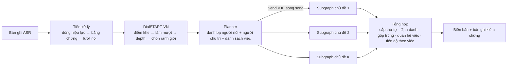
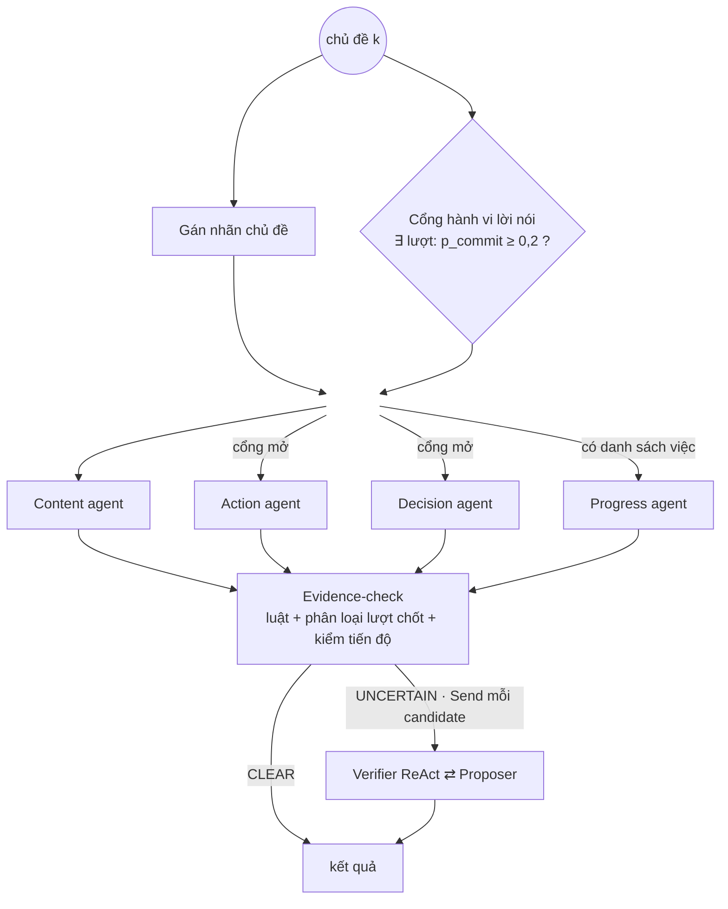

# DiVA: Cắt chủ đề hội thoại và đa tác tử có kiểm chứng đồng thuận để sinh biên bản họp tiếng Việt

**DiVA: Dialogue Segmentation and Verified Agents for Grounded Vietnamese Meeting Minutes**

*Bản thảo bài báo. Cập nhật: 12/10/2026.*

---

## Tóm tắt

Biên bản họp hành chính phải nêu đúng **ai được giao việc gì, hạn khi nào, cuộc họp đã kết luận
gì, và các việc cũ đang tiến triển ra sao**. Sai ở những chi tiết này đắt hơn nhiều so với một câu
văn kém trôi chảy. Chúng tôi đề xuất **DiVA**, một hệ thống hai tầng sinh biên bản có căn cứ từ bản
ghi nhận dạng giọng nói (ASR) tiếng Việt.

- **Tầng một, DialSTART‑VN**: cắt cuộc họp thành các đoạn chủ đề dựa trên độ mạch lạc giữa các lượt
  nói. Bộ chọn ranh giới mới không cần biết trước số chủ đề và bảo đảm mỗi đoạn vừa ngữ cảnh của LLM.
- **Tầng hai, đa tác tử**: xử lý mọi chủ đề song song theo kiểu map–reduce. Một **bộ phân loại hành vi
  lời nói đã hiệu chỉnh xác suất** được dùng ở ba chỗ:
  1. *cổng* quyết định có chạy agent trích xuất việc giao và kết luận hay không;
  2. *phân loại sơ bộ* candidate thành chắc chắn và nghi ngờ;
  3. *kiểm trạng thái* của các việc cần báo cáo tiến độ.

  Candidate nghi ngờ được một **Verifier ReAct** kiểm. Verifier có công cụ chỉ đọc tra được toàn bộ
  cuộc họp, rồi trao đổi với agent trích xuất trong một **giao thức đồng thuận** có ngân sách giới hạn
  và luật kết thúc an toàn.

Về kết quả, bộ chọn ranh giới nâng điểm cắt chủ đề tổng hợp trên gold thật từ 0,392 lên 0,637. Bộ
phân loại hành vi lời nói đạt F1 0,894 (luật từ khoá: 0,682), ECE 0,040. Dùng nó làm cổng ở ngưỡng
$p \ge 0{,}2$ không bỏ sót mục gold nào, trong khi luật từ khoá làm mất 3 mục. Trên một cuộc họp có
danh sách việc, thành phần theo dõi tiến độ khớp 4/4 trạng thái việc qua 4 lần chạy. Hệ thống xử lý
một cuộc họp 1.259 lượt nói trong khoảng 78 giây. Chúng tôi nêu rõ giới hạn của các bằng chứng này,
và đề xuất một giao thức đánh giá end‑to‑end.

---

## 1. Giới thiệu

Soạn biên bản cho một phiên họp hành chính mất nhiều giờ. Biên bản thường có bốn phần: diễn biến
thảo luận theo người phát biểu, các việc được giao, các kết luận, và (ở họp giao ban hay họp kiểm
điểm) tình hình thực hiện các việc đã giao từ trước. Mô hình ngôn ngữ lớn (LLM) viết tóm tắt trôi
chảy, nhưng biên bản đòi hỏi **độ chính xác có căn cứ**:

- một việc không ai giao mà xuất hiện trong biên bản là lỗi nghiêm trọng;
- một đề xuất chưa được chấp nhận mà bị ghi thành kết luận cũng vậy;
- giao nhầm người, hay báo cáo "đã xong" cho một việc thực ra bị yêu cầu làm lại, đều có hậu quả
  hành chính.

Bản ghi ASR tiếng Việt thực tế làm bài toán khó thêm theo năm hướng:

- **(K1) Độ dài và cấu trúc.** Một phiên dài từ 5 nghìn tới 260 nghìn ký tự, gồm nhiều mục nghị sự.
- **(K2) Khoảng cách giữa dữ liệu huấn luyện và dữ liệu thật.** Bộ cắt chủ đề học trên hội thoại tổng
  hợp, nhưng phải chạy trên cuộc họp thật: cùng một dự án, cùng từ vựng, cùng người nói.
- **(K3) Định danh tác nhân.** Ví dụ: "anh Sơn" khi cuộc họp có hai người tên Sơn; việc giao cho đơn
  vị ("Sở Tài chính chủ trì, phối hợp Sở Xây dựng"); đại từ "em", "bên em".
- **(K4) Hành vi lời nói mơ hồ.** Lời giao việc thường ở dạng khẩu ngữ hoặc câu hỏi ("anh Phong gửi
  giúp em trong tuần này được không ạ?"). "Đề nghị" của chủ trì là chỉ đạo, còn của đại biểu chỉ là
  kiến nghị.
- **(K5) Nhãn người nói không tin cậy.** Bộ phân tách người nói (diarization) có thể gộp người trình
  bày và người chủ trì vào cùng một nhãn.

Một hướng làm đơn giản là gọi một LLM trên từng chủ đề rồi tin kết quả. Cách này không kiểm soát được
lỗi bịa (K4) và lỗi định danh (K3). Ngược lại, kiểm chứng mọi mục bằng tranh luận đa tác tử lại tốn
chi phí tuyến tính theo số mục, và chỉ thấy được đoạn hiện tại. Trong khi đó, lượt chốt có thể nằm ở
một chủ đề khác.

**Ý tưởng chính** của DiVA là **kiểm chứng chọn lọc theo tầng**. Chi phí tăng theo mức độ nghi ngờ:

1. luật tất định, 0 token;
2. bộ phân loại hành vi lời nói đã hiệu chỉnh, khoảng 0,3 s mỗi lượt;
3. Verifier ReAct có công cụ, cộng giao thức đồng thuận, chỉ dành cho phần thật sự mơ hồ.

Cũng bộ phân loại ở tầng 2 được dùng *trước* khi trích xuất, như một cổng để bỏ các agent không cần
thiết.

**Đóng góp** của bài báo:

1. **DialSTART‑VN** (Mục 4.2). Chúng tôi huấn luyện mô hình mạch lạc lượt‑cặp trên backbone tiếng
   Việt, tăng tốc suy luận khoảng $2w$ lần, và đề xuất bộ chọn ranh giới không cần oracle với ràng buộc
   ký tự tỉ lệ theo độ dài cuộc họp.
2. **Kiến trúc map–reduce cho phân tích biên bản** (Mục 4.3). Ngữ cảnh chạy dồn giữa các chủ đề được
   thay bằng một danh bạ người nói dựng một lần, nên các chủ đề độc lập với nhau và độ trễ không còn
   tăng tuyến tính theo số chủ đề.
3. **Một bộ phân loại, ba vai trò** (Mục 4.4–4.5). Bộ phân loại hành vi lời nói đã hiệu chỉnh xác suất
   vừa là cổng chọn agent, vừa phân loại sơ bộ candidate, vừa (với bộ câu hỏi riêng) kiểm trạng thái
   tiến độ. Ngưỡng ba vùng được chọn dựa trên độ hiệu chỉnh xác suất.
4. **Giao thức đồng thuận Verifier ⇄ Proposer** (Mục 4.6). Giao thức có ba lập trường (accept / amend
   / defend). Thứ tự trường JSON được dùng như một ràng buộc suy luận "bằng chứng trước, kết luận sau",
   và bảng kết thúc bảo đảm lỗi hạ tầng không xoá nội dung đã trích.
5. **Theo dõi tiến độ theo danh sách việc** (Mục 4.8). Thành phần này trích trạng thái từng việc cũ,
   kiểm bằng câu hỏi tuỳ theo kiểu việc, gộp theo việc (lời chỉ đạo thắng lời báo cáo), và xác định
   quan hệ của việc giao mới với việc cũ: *tiếp nối / giao lại / đổi hạn / mới*.

---

## 2. Công trình liên quan

**Cắt chủ đề hội thoại.** TextTiling (Hearst, 1997) đặt nền cho *depth score* trên chuỗi độ tương
đồng giữa hai cửa sổ. TreeSeg (Gklezakos et al., 2024) phân cụm chia dần trên embedding. Xing &
Carenini (2021) chấm điểm mạch lạc lượt‑cặp bằng đầu NSP của BERT. DialSTART (Gao et al., 2023) bổ
sung biểu diễn chủ đề học bằng đối sánh tương phản trên phân đoạn giả. Các hướng dùng LLM, như phân
loại ý định từng lượt (Def‑DTS) hay sinh mục lục nhiều tầng, cho thấy zero‑shot còn cách xa bản
fine‑tune. "When F1 Fails" chỉ ra rằng chọn ngưỡng (độ mịn) ảnh hưởng tới điểm nhiều hơn chọn phương
pháp. Đây là động lực để chúng tôi đầu tư vào bộ chọn ranh giới thay vì dùng số ranh giới oracle.

**Trích xuất từ cuộc họp.** Nghiên cứu trên AMI và ICSI (Carletta et al., 2005; Janin et al., 2003)
về phát hiện action item (Purver et al., 2007) và tóm tắt hướng truy vấn (QMSum; Zhong et al., 2021)
chủ yếu dùng tiếng Anh. Các nghiên cứu này không đòi hỏi trích dẫn tới từng lượt nói, không định danh
đơn vị và không theo dõi tiến độ việc cũ.

**Tác tử LLM và tự kiểm chứng.** ReAct (Yao et al., 2023) xen kẽ suy nghĩ và hành động công cụ.
Plan‑and‑Solve (Wang et al., 2023) tách bước lập kế hoạch khỏi bước thực thi. Tranh luận đa tác tử
(Du et al., 2023; Liang et al., 2023), Self‑Refine (Madaan et al., 2023) và CRITIC (Gou et al., 2024)
dùng phản hồi để sửa đầu ra. DiVA khác các hướng trên ở ba điểm:

- kiểm chứng là **chọn lọc** và có **phân loại sơ bộ đã hiệu chỉnh**, thay vì áp cho mọi đầu ra;
- mọi lượt trao đổi phải neo vào một `turn_id` có thật và qua **luật hậu kiểm tất định**;
- giao thức có **ngân sách cứng** và quy tắc kết thúc thiên về giữ nội dung.

**Phân loại có hiệu chỉnh để định tuyến.** Dùng xác suất đã hiệu chỉnh để quyết định khi nào chuyển
sang mô hình đắt hơn là ý tưởng quen thuộc trong cascade và selective prediction (Geifman &
El‑Yaniv, 2017; Chen et al., 2023, FrugalGPT). Chúng tôi áp dụng ý tưởng này cho định tuyến *giữa các
agent* trong một pipeline trích xuất có căn cứ.

---

## 3. Định nghĩa bài toán

**Đầu vào.** Bản ghi gồm các lượt nói $\mathcal{T} = (u_1,\dots,u_n)$, mỗi lượt
$u_i = (\iota_i, s_i, x_i)$ gồm mã lượt, nhãn người nói và nội dung. Siêu dữ liệu tuỳ chọn gồm:

- ngày họp $\delta$ và người chủ trì $c$;
- danh sách tham dự $\mathcal{R}$: người (họ tên, chức vị, đơn vị) và đơn vị (tên, tên gọi tắt,
  chức năng);
- danh sách việc cần báo cáo $\mathcal{G} = \{g_j\}$, với
  $g_j = (\text{id}, \text{tiêu đề}, \text{chủ trì}, \text{phối hợp}, \text{hạn}, \sigma^0_j)$ và
  $\sigma^0_j \in \{\text{not\_started}, \text{in\_progress}, \text{done}, \text{blocked}\}$.

**Cắt chủ đề.** Tìm ranh giới $B = \{b_1 < \dots < b_{K-1}\}$ để tạo $K$ đoạn liền mạch
$S_1,\dots,S_K$, sao cho mỗi đoạn có $|S_k|_{\text{char}} \le L_{\max}$. Điều kiện này chỉ được nới khi
một lượt đơn lẻ đã dài hơn $L_{\max}$.

**Đầu ra.** Gồm bốn phần:

- **Diễn biến** $\mathcal{D}$: các luận điểm $(k, s, \text{text}, E)$, với $E \subseteq \text{ids}(S_k)$.
- **Giao việc** $\mathcal{A}$: các bộ
  $(\text{text}, \text{actor}, \tau, \text{assignees}, \text{deadline}, d^\*, \kappa, E, t^\*, \text{task\_id}, \rho)$. Trong đó:
  - $\tau \in \{\text{person}, \text{organization}, \text{unknown}\}$ là loại tác nhân;
  - assignees là các bên nhận việc kèm vai trò (chủ trì / phối hợp / cùng thực hiện);
  - $d^\*$ là ngày chuẩn hoá và $\kappa$ là kiểu hạn
    ($\kappa \in \{\text{exact}, \text{before}, \text{end\_of\_period}, \text{relative}, \text{unknown}\}$);
  - $t^\*$ là lượt giao hoặc nhận việc;
  - $\rho \in \{\text{new}, \text{follow\_up}, \text{reassign}, \text{reschedule}\}$ là quan hệ với việc cũ.
- **Kết luận** $\mathcal{C}$: các bộ $(\text{text}, E, t^\*)$, với $t^\*$ là lượt chốt.
- **Tiến độ** $\mathcal{P}$ (khi có $\mathcal{G}$): mỗi việc $g_j$ có trạng thái mới
  $\sigma_j \in \Sigma \cup \{\text{not\_reported}\}$, với
  $\Sigma = \{\text{done}, \text{in\_progress}, \text{blocked}, \text{returned}, \text{deferred}, \text{mentioned}\}$,
  kèm hạn mới, cờ mâu thuẫn, cờ quá hạn và các cập nhật có bằng chứng.

**Ràng buộc căn cứ.**

- (i) Mọi $E$ chỉ chứa mã lượt thật.
- (ii) Câu trích chỉ được giữ nếu là chuỗi con của lượt nói.
- (iii) Một việc giao hoặc kết luận đã qua kiểm chứng phải có $t^\*$ thuộc cuộc họp. $t^\*$ có thể nằm
  ở chủ đề khác.
- (iv) Không việc nào trong $\mathcal{G}$ bị xoá khỏi đầu ra.

---

## 4. Phương pháp

### 4.1. Tổng quan



Mỗi subgraph chủ đề chạy như sau:



**Tiền xử lý.** Hệ thống áp bản sửa của người duyệt lên ASR, rồi "đóng băng" từng dòng thành bằng chứng
có mã ổn định. Các dòng liên tiếp được gộp thận trọng thành lượt nói: chỉ gộp khi cùng người nói đã xác
định, cùng vai trò, và cách nhau không quá 5 s. Lượt nói là đơn vị nhỏ nhất cho cả cắt chủ đề lẫn trích
dẫn.

### 4.2. DialSTART‑VN: cắt chủ đề dựa trên mạch lạc

**Mô hình.** Mô hình có hai bộ mã hoá, cùng khởi tạo từ `NlpHUST/vibert4news-base-cased`:

- nhánh chủ đề $f_\theta$: lấy pooled output của mỗi lượt làm embedding chủ đề $\mathbf{e}_i$;
- nhánh mạch lạc $g_\phi$: BERT có đầu NSP, trả logit "liền mạch" $\ell$ cho cặp (ngữ cảnh trái, lượt
  kế tiếp).

Với khe $g$ giữa $u_g$ và $u_{g+1}$, cửa sổ $w=2$:

$$
\text{score}(g)=\sigma\!\Big(\ell\big([x_{g-w+1..g}]_{\texttt{[SEP]}},\,x_{g+1}\big)+\cos\big(\bar{\mathbf e}_{g-w+1..g},\,\bar{\mathbf e}_{g+1..g+w}\big)\Big)
$$

Điểm thấp nghĩa là khe dễ là ranh giới.

**Huấn luyện** theo DialSTART trên hội thoại tiếng Việt tổng hợp:

$$
\mathcal L=\max\big(0,\,m-(s^{+}-s^{-})\big)+\mathcal L_{\text{topic}},\qquad s^{\pm}=\ell^{\pm}+\cos^{\pm},\ m=1
$$

$\mathcal L_{\text{topic}}$ là margin tương phản trên **phân đoạn giả**. Cách dựng: tính depth trên độ
tương đồng chủ đề và lấy 5 khe sâu nhất làm ranh giới giả. Với mỗi lượt neo, các lượt cùng đoạn giả là
dương, các lượt ngoài đoạn là âm.

**Suy luận hiệu quả và trung thành với lúc huấn luyện.**

- *Mã hoá đúng như lúc huấn luyện.* Bộ đánh giá gốc cắt mỗi lượt còn 128 ký tự, trong khi khoảng 1/3
  số lượt trong cuộc họp thật dài hơn thế. Chúng tôi giữ cả lượt (tối đa 256 token) cho nhánh chủ đề,
  và giữ 256 token *cuối* của ngữ cảnh trái cho NSP.
- *Mã hoá mỗi lượt một lần.* Pooled output không phụ thuộc padding, nên mỗi lượt chỉ cần mã hoá một lần.
  Trung bình cửa sổ được tính bằng tổng tích luỹ $\mathbf P_j=\sum_{i<j}\mathbf e_i$, mỗi khe $O(1)$,
  nhanh hơn khoảng $2w$ lần so với mã hoá lại từng cửa sổ.
- *Gom batch theo độ dài*, với trần (số câu × độ dài lớn nhất) $\le 4096$ token.

**Bộ chọn ranh giới không cần oracle.** Bộ đánh giá gốc chọn đúng $K^\*-1$ khe sâu nhất, với $K^\*$ là
số chủ đề thật, nên không dùng được khi triển khai. Chúng tôi làm như sau. Trước hết làm mượt điểm
khe bằng trung bình trượt cửa sổ 3, rồi tính depth kiểu TextTiling:

$$
\text{depth}(g)=\tfrac12\big(\text{peak}_L(g)+\text{peak}_R(g)-2\,\text{score}(g)\big).
$$

Sau đó áp Thuật toán 1.

```
Thuật toán 1: SELECT‑BOUNDARIES(depth, chars, emb)
  τ ← mean(depth) + α·std(depth)                           ▷ α = 1,0
  E ← {0, n}
  for g theo depth giảm dần, while depth[g] > τ:               ▷ (a) ngưỡng
      if cả hai phía của g+1 có ≥ m_min lượt: thêm g+1 vào E    ▷ m_min = 4
  while đoạn ngắn nhất < C_min ký tự:                       ▷ (b) bỏ đoạn vụn
      xoá trong hai mép của đoạn đó mép có depth thấp hơn
  [tuỳ chọn] gộp cặp đoạn kề có cos(emb trung bình) ≥ β nếu đoạn gộp ≤ L_max   ▷ (c)
  for mỗi đoạn có ký tự > L_max:                            ▷ (d) ràng buộc cứng
      tách tại khe depth cao nhất bên trong (ưu tiên khe giữ ≥ m_min lượt mỗi bên), lặp
  return E \ {0, n}
```

Sàn ký tự tỉ lệ theo độ dài cuộc họp:
$C_{\min}=\operatorname{clip}\!\big(\lfloor\textstyle\sum_i|u_i|/15\rfloor,\,1500,\,10000\big)$, với
$L_{\max}=35.000$. Văn bản đưa vào mô hình *không* kèm tên người nói, giống dữ liệu huấn luyện. Còn độ
dài dùng cho các ràng buộc được đo trên dòng "người nói: nội dung", chính là chuỗi sẽ vào prompt phía
sau.

### 4.3. Planner và xử lý song song theo chủ đề

**Danh bạ người nói** $\mathcal S$ được dựng *một lần* cho cả cuộc họp (0 token). Danh bạ gồm:

- tên người nói không trùng, theo thứ tự xuất hiện;
- người chủ trì $c$, được quy về đúng nhãn người nói nếu khớp duy nhất một người;
- danh sách tham dự $\mathcal R$ và danh sách việc $\mathcal G$.

Ở hệ thống trước (v1), ngữ cảnh tên người được chuyển dồn từ chủ đề này sang chủ đề sau, nên các chủ
đề phải chạy tuần tự. $\mathcal S$ thay ngữ cảnh đó: mọi chủ đề đọc cùng một danh bạ, kể cả tên người
chỉ xuất hiện ở chủ đề sau, và tên do agent tự gán (có thể sai) không lan sang chủ đề khác.

**Map–reduce.** Graph cha phát một gói `Send` cho *mọi* chủ đề cùng lúc. Mỗi gói mang theo các lượt của
chủ đề, toàn bộ lượt của cuộc họp (dùng cho công cụ của Verifier) và $\mathcal S$. Trong mỗi subgraph,
gán nhãn chủ đề chạy song song với cổng hành vi lời nói (Mục 4.4). Các nhánh trích xuất nối thẳng vào
bước evidence‑check. Mọi nhánh cách điểm phân nhánh đúng một bước, nên kết quả của chúng được ghi trong
cùng một *superstep*, và evidence‑check chạy đúng một lần dù số nhánh thay đổi. Kết quả các chủ đề được
cộng dồn bằng reducer. Bước tổng hợp sắp lại theo thứ tự chủ đề (thứ tự hoàn thành là ngẫu nhiên) và
gộp các mục trùng giữa các chủ đề.

**Giới hạn tài nguyên.** Một semaphore dùng chung cả tiến trình bọc mọi adapter LLM, nên số lời gọi
đồng thời luôn bị chặn bất kể có bao nhiêu chủ đề.

### 4.4. Bộ phân loại hành vi lời nói và cổng chọn agent

**Bộ phân loại.** Đầu vào của $h$ là lượt cần xét kèm 2 lượt ngữ cảnh đứng trước. Lượt dài hơn 2.500 ký
tự được cắt theo câu thành nhiều cửa sổ. Đầu ra là phân bố trên
$\mathcal Y=\{\text{giao\_việc}, \text{kết\_luận}, \text{đề\_xuất}, \text{bác\_bỏ}, \text{thảo\_luận}, \text{khác}\}$.
Hướng dẫn của bộ phân loại yêu cầu xét *theo nghĩa*: khẩu ngữ ("nhá", "cứ làm đi") vẫn có thể là
giao/chốt, và "đề nghị" của chủ trì khác "đề nghị" của đại biểu. Xác suất chốt được định nghĩa là

$$
p_{\text{commit}}(u)=h(\text{giao\_việc}\mid u)+h(\text{kết\_luận}\mid u).
$$

Hai ngưỡng $\tau_{\text{rej}}=0{,}2$ và $\tau_{\text{acc}}=0{,}8$ chia trục xác suất thành ba vùng: *rõ là
không*, *mơ hồ* và *rõ là có*. Hai ngưỡng này được chọn trên tập hiệu chỉnh: ở vùng
$p<0{,}2$ chỉ 4% lượt là lượt chốt thật, ở vùng $p\ge 0{,}8$ có 92% (Mục 6.2).

**Cổng chọn agent.** Action agent và Decision agent chỉ chạy trên chủ đề $S_k$ khi

$$
\exists\, u \in S_k,\ \exists\,\text{cửa sổ } \omega \text{ của } u:\ p_{\text{commit}}(\omega) \ge \tau_{\text{rej}}.
$$

Cổng duyệt các lượt **từ cuối lên**, vì lời chốt thường nằm ở cuối chủ đề, và dừng ngay ở cửa sổ đầu
tiên vượt ngưỡng. Khi bộ phân loại lỗi, cổng mở, vì chạy thừa chỉ tốn một lời gọi còn bỏ nhầm thì mất
kết quả. Content agent không bao giờ bị bỏ. Hai agent dùng chung $p_{\text{commit}}$ thay vì lọc riêng
theo nhãn, vì một phần lượt chốt kết luận bị xếp vào nhãn giao việc (Mục 6.3). Với lượt ngắn, đầu vào
của cổng trùng với đầu vào của evidence‑check, nên kết quả phân loại được dùng lại.

### 4.5. Agent trích xuất và evidence‑check

**Agent trích xuất.** Ba agent (Content, Action, Decision) mỗi agent tốn một lời gọi trên một chủ đề, với
schema JSON cố định. Prompt có các quy tắc chung:

- *Bằng chứng trước*: chọn `evidence_turn_ids` trước khi viết nội dung.
- *Ngôi thứ ba*: không dùng đại từ trần trụi, không đoán tên.
- *Quy tắc chủ trì*: khi người chủ trì nói "đề nghị/yêu cầu/giao + người/đơn vị + việc" thì đó là
  **giao việc**, kể cả khi không có chữ "giao". Cùng câu đó do thành viên khác nói thì chỉ là đề xuất.
- *Nhãn người nói có thể gộp nhiều người*, nên vai của mỗi lượt được xét theo nội dung (K5).
- *Khai trung thực*: chỉ đánh dấu `proposed`/`reported` khi không chắc. Chắc là đề xuất chưa ai nhận
  hay báo cáo tiến độ thì không đưa vào, vì mỗi mục nghi ngờ tốn vài lời gọi kiểm chứng.

Hạn chót được chuẩn hoá theo ngày họp, theo một bộ quy ước tường minh: tuần kết thúc vào Chủ nhật,
"tháng sau" là ngày cuối tháng kế, "A hoặc B" lấy mốc muộn hơn, v.v. Một module luật đóng vai trò dự
phòng. Lỗi LLM được thử lại ngay tại chỗ, tối đa 2 lần.

**Evidence‑check** phân mỗi candidate vào CLEAR (vào kết quả ngay) hoặc UNCERTAIN (gửi Verifier, kèm lý
do bị gắn cờ). Một *việc giao* bị gắn cờ khi:

- actor rỗng hoặc chung chung ("nhóm", "một thành viên");
- actor không có căn cứ trong bản ghi hay danh bạ (từ chỉ vai trò như "chủ trì", "phối hợp với" được bỏ
  trước khi kiểm);
- actor khớp từ hai ứng viên trở lên mà không ai đủ rõ;
- lượt chốt không phải lời giao hoặc nhận việc.

Một *kết luận* bị gắn cờ khi lượt chốt không phải lời chốt. Với lượt chốt $t$, luật từ khoá được thay
bằng $h$:

$$
\text{flag}(t)=
\begin{cases}
\varnothing & p_{\text{commit}}(t)\ge\tau_{\text{acc}}\\
\text{"chưa rõ"} + h(\cdot\mid t) & \tau_{\text{rej}}\le p_{\text{commit}}(t)<\tau_{\text{acc}}\\
\text{"không phải lời chốt"} & p_{\text{commit}}(t)<\tau_{\text{rej}}
\end{cases}
$$

Khi API phân loại lỗi hoặc quá thời gian chờ (10 s), hệ thống quay về luật từ khoá.

### 4.6. Verifier ReAct và giao thức đồng thuận

**Verifier.** ReAct được dựng trên giao diện sinh JSON một lượt, nên không cần provider hỗ trợ tool
calling. Mỗi bước, mô hình trả về

$$
(\text{thought},\ \text{action},\ \text{argument},\ \underbrace{\text{deciding\_turn\_id}}_{\text{trước}},\ \text{verdict},\ \text{revised\_actor},\ \text{revised\_actor\_type},\ \text{actor\_reason},\ \text{reasoning}),
$$

với $\text{verdict}\in\{\text{keep}, \text{revise}, \text{drop}, \text{unresolved}\}$. Mã nguồn chạy công
cụ được gọi, rồi đưa suy nghĩ, hành động và observation của mọi bước trước vào prompt lượt sau. Ba công
cụ đều chỉ đọc:

- `get_turn(id)` trả nguyên văn một lượt bất kỳ trong cả cuộc họp. Hàm chấp nhận cả các dạng viết tắt mà
  mô hình hay dùng ("T30", "30") khi số đó ứng với đúng một lượt.
- `search_meeting(q)` trả top‑5 lượt theo BM25 ($k_1=1{,}2$, $b=0{,}75$) trên âm tiết nội dung và cặp
  âm tiết (cặp âm tiết có trọng số ×2), cắt quanh chỗ khớp.
- `lookup_speaker(mention@id)` trả các ứng viên người/đơn vị kèm điểm, lý do và nhãn rõ ràng/mơ hồ
  (Mục 4.7).

Có bốn quyết định thiết kế đáng chú ý:

- (i) **Thứ tự trường như ràng buộc suy luận.** Mô hình tự hồi quy sinh JSON theo thứ tự trường. Đặt
  `deciding_turn_id` trước `verdict` buộc mô hình chỉ ra lượt giao/chốt trước khi kết luận, thay vì chọn
  nhãn rồi tìm bằng chứng cho khớp.
- (ii) **Cờ của bộ lọc là gợi ý, không phải bằng chứng.** Trước khi kết luận drop, Verifier phải đọc
  các lượt tổng kết của người chủ trì.
- (iii) **Ngân sách.** Mỗi vòng có tối đa $T+1$ lời gọi ($T=3$), và lượt cuối buộc phải kết luận. Gọi
  lại y hệt một công cụ đã gọi thì công cụ không chạy lại.
- (iv) **Luật hậu kiểm tất định.**
  - `keep`/`revise` không có `deciding_turn_id` thuộc cuộc họp thì bị hạ thành `drop`.
  - Actor do Verifier chọn phải trùng tên một ứng viên công cụ đã trả về và phải kèm lý do; nếu không,
    hệ thống dùng kết quả của luật.
  - Lượt chốt được phép nằm ở chủ đề khác.

**Giao thức đồng thuận.** Giao thức thay cho bước duyệt người. Bên đề xuất (Proposer) là chính agent đã
sinh ra candidate.

```
Thuật toán 2: VERIFY‑WITH‑CONSENSUS(x₀), tối đa R = 3 vòng
  x ← x₀; H ← []
  for r = 1..R:
      (v, t*, x̂, fb) ← Verifier(x, H)               ▷ lỗi LLM → return (x₀, fallback)
      if v = keep: return (x̂, consensus)
      (σ, t_p, arg) ← Proposer(x, v, fb, observations, H)   ▷ σ ∈ {accept, amend, defend}
      if σ = accept ∧ t_p là lượt thật ∧ v ≠ revise: σ ← defend   ▷ tự mâu thuẫn
      H.append((x, steps, v, fb, t*, σ, arg, t_p))
      if σ = accept: return (x̂ nếu v = revise, ngược lại DROP; consensus)
      if σ = amend:  x ← bản sửa, chỉ nhận nếu t_p là lượt thật và actor định danh được
      # σ = defend: giữ x, vòng sau Verifier xét lại kèm lập luận
  if v = unresolved: return (x₀, fallback)
  return (kết luận cuối của Verifier, verifier)
```

| Kết thúc | Kết quả | Nhãn |
|---|---|---|
| Đồng thuận | keep/revise thì giữ, drop thì bỏ | `consensus` |
| Hết vòng, Verifier đã kết luận | theo Verifier | `verifier` |
| Hết vòng, vẫn `unresolved` | giữ candidate **gốc** | `fallback` |
| Lỗi LLM ở bất kỳ bước nào | giữ candidate **gốc** | `fallback` |

Hai bất biến an toàn của giao thức: lỗi hạ tầng không bao giờ xoá nội dung đã trích, và bản do agent tự
sửa mà Verifier chưa xét lại không bao giờ vào kết quả. Proposer cũng điền `confirm_turn_id` *trước*
`stance`. Trường văn bản tự do được đặt cuối schema: với một mô hình mở, chúng tôi quan sát thấy hiện
tượng sinh khoảng trắng vô tận khi sau trường tự do vẫn còn trường bắt buộc.

### 4.7. Định danh tác nhân có giải thích

Mỗi cách gọi (mention) được so với các ứng viên lấy từ danh bạ, danh sách tham dự và các dạng tên đơn vị
trong bản ghi. Điểm của ứng viên $a$ được tính theo thứ tự ưu tiên:

$$
\text{score}(a)=\underbrace{\text{name}(a)}_{1{,}0\,/\,0{,}7\,/\,0{,}6}\ +\ \underbrace{\text{ctx}(a)}_{\pm 0{,}3}\ +\ \mathbb 1[\text{ctx chưa phân định}]\cdot\min\!\big(0{,}3,\ 0{,}1\cdot|\text{terms}(a)\cap\text{terms}(\text{việc})|\big).
$$

- *Tên.* Khớp họ tên, tên đơn vị hoặc tên gọi tắt: 1,0. Khớp một phần tên đơn vị: 0,7. Khớp tên gọi,
  hoặc dạng tên đơn vị ngoài danh sách: 0,6.
- *Ngữ cảnh quanh lượt chốt.* Người nói ngay sau lượt chốt được +0,3. Người giao việc ở lượt chốt bị
  −0,3 (không ai tự gọi mình là "anh Sơn"); với việc tự nhận thì được +0,3.
- *Chức năng.* Chỉ xét khi ngữ cảnh chưa phân định: mỗi âm tiết nội dung của việc trùng với chức vị,
  đơn vị hoặc chức năng của ứng viên được +0,1, tối đa +0,3.

Ứng viên đứng đầu là *rõ ràng* khi $\text{score}_1\ge 0{,}6$ và $\text{score}_1-\text{score}_2\ge 0{,}2$.
Nếu không, hệ thống gán $\tau=\text{unknown}$, giữ danh sách ứng viên kèm điểm để người đọc tự quyết, và
**không bỏ việc giao**.

Actor ghép được tách thành các bên kèm vai trò lead / support / joint. Tên đơn vị được chuẩn hoá trước
khi so: "UBND TP", "Ủy ban nhân dân Thành phố" và "UBND Thành phố" là một, nhưng HĐND vẫn khác UBND.

### 4.8. Theo dõi tiến độ theo danh sách việc

Thành phần này chỉ chạy khi có danh sách việc $\mathcal G$. Khi không có, số lời gọi, prompt và schema
của toàn hệ thống giữ nguyên.

**(1) Trích xuất.** Progress agent tốn một lời gọi mỗi chủ đề và nhận cả $\mathcal G$. Với mỗi việc được
nhắc tới, agent trả một cập nhật gồm: mã việc (enum đóng), trạng thái $\in\Sigma$, lượt nêu trạng thái,
bằng chứng, hạn mới hoặc cờ bỏ hạn, rồi tóm tắt, vướng mắc và chỉ đạo. Prompt quy định ba điều: nhắc
chung cả đề án thì không tính là nhắc từng việc; lượt nêu trạng thái là lượt kết luận/chỉ đạo *cuối
cùng* của người chủ trì nếu có; và lượt nêu hạn mới phải nằm trong bằng chứng. Parser bỏ các mục có mã
lạ hoặc không có bằng chứng.

**(2) Kiểm bằng câu hỏi tuỳ kiểu việc.** Trước hết, mỗi việc được một bộ phân loại kiểu việc
$h^{\text{kind}}$ xếp loại một lần: *báo cáo tại họp* hay *làm ra sản phẩm*. Từ đó chọn câu hỏi kiểm:

$$
h^{\text{st}}=\begin{cases}h^{\text{report}} & h^{\text{kind}}(\text{báo cáo}\mid g)\ge 0{,}8\\ h^{\text{progress}} & \text{ngược lại}\end{cases}
$$

- $h^{\text{progress}}$ có 7 nhãn: báo cáo xong / đang làm / vướng mắc, yêu cầu làm lại, hoãn, chỉ nhắc,
  không liên quan.
- $h^{\text{report}}$ coi việc *đã xong khi nội dung được trình bày*. Lý do tách riêng: với việc kiểu
  "báo cáo tình hình các dự án", tình trạng của đối tượng được báo cáo ("dự án đang làm thủ tục") là
  *nội dung* báo cáo, không phải trạng thái của việc.

Bộ kiểm duyệt các lượt nêu trạng thái, bắt đầu từ lượt agent khai rồi tới các lượt bằng chứng khác, từ
lượt muộn nhất:

| Điều kiện (ngưỡng 0,8) | Quyết định |
|---|---|
| Một cửa sổ xác nhận đúng trạng thái agent khai | giữ |
| Không cửa sổ nào xác nhận; lượt đầu tiên có trạng thái rõ khác | sửa theo bộ phân loại (không đổi giữa các trạng thái *báo cáo* bằng câu hỏi chung) |
| Agent khai trạng thái báo cáo; tổng nhóm báo cáo ≥ 0,8 | giữ trạng thái agent khai, cờ `kept` |
| `mentioned` nhưng mọi lượt có p(không liên quan) ≥ 0,8 | **bỏ** cập nhật (agent gắn nhầm việc) |
| `mentioned` nhưng có lượt là báo cáo rõ | nâng lên trạng thái đó |
| `mentioned` nhưng có lượt là làm lại/hoãn | chỉ nâng khi $p_{\text{commit}}\ge 0{,}8$, tức là lời chỉ đạo chứ không phải kiến nghị |
| Còn lại | hạ về `mentioned`, cờ `uncertain` |
| Bộ phân loại tắt hoặc lỗi | giữ điều agent khai, cờ `unchecked` |

Quyết định "xong hay đang làm" đối với việc làm ra sản phẩm được để agent đưa ra, vì agent đọc cả chủ
đề. Bộ phân loại chỉ quyết lượt nói là báo cáo, chỉ đạo hay chỉ nhắc (Mục 6.4 giải thích lý do).

**(3) Gộp theo việc.** Trong các cập nhật có trạng thái rõ của cùng một việc, lời **chỉ đạo/kết luận**
(xác suất là chỉ đạo $\ge 0{,}8$) thắng lời **báo cáo**. Cùng loại thì lượt muộn hơn thắng. Quy tắc này
*không dựa vào nhãn người nói*, vì nhãn có thể gộp nhiều người (K5). Ba cờ được tính thêm:

- *mâu thuẫn*: có một báo cáo "xong" đã xác nhận cùng một trạng thái rõ khác. "Đang làm" rồi bị trả lại
  là diễn tiến bình thường, không phải mâu thuẫn;
- *not_reported*: không chủ đề nào nhắc tới việc;
- *quá hạn*: hạn cũ trước ngày họp mà việc chưa xong.

**(4) Quan hệ việc giao ↔ việc cũ.** Khi có $\mathcal G$, schema của Action agent có thêm trường
$\text{task\_id}\in\text{ids}(\mathcal G)\cup\{\text{new}\}$. Chỉ ghi mã việc khi việc giao là *chính* việc
đó (làm tiếp, làm lại, giao bên khác, đổi hạn). Sản phẩm mới phát sinh trong phiên thì ghi `new`, kể cả
khi nó phục vụ việc cũ. Quan hệ $\rho$ được suy ra *tất định* từ các trường, không so khớp chữ:

$$
\rho=\begin{cases}
\text{new} & \text{task\_id}=\varnothing\\
\text{reassign} & \text{việc được giao} \wedge \text{mọi bên nhận} \notin \text{chủ trì/phối hợp cũ}\\
\text{reschedule} & \text{hạn mới}\ne\text{hạn cũ}\\
\text{follow\_up} & \text{còn lại}
\end{cases}
$$

Định danh actor không cộng điểm cho bên chủ trì cũ, để không che mất trường hợp giao lại. Hai việc giao
gắn với hai việc cũ khác nhau không bao giờ bị gộp làm một.

### 4.9. Phân tích chi phí

Ký hiệu:

- $K$: số chủ đề; $K_g\le K$: số chủ đề cổng mở;
- $M$: số candidate nghi ngờ;
- $R$: số vòng đồng thuận tối đa; $T$: số lời gọi công cụ tối đa mỗi vòng;
- $n_k$: số cửa sổ phân loại của chủ đề $k$.

| | v1 (tuần tự, Debate+Judge) | DiVA |
|---|---|---|
| Lời gọi trích xuất | $3K$ | $K + 2K_g$ (+ $K$ nếu có $\mathcal G$) |
| Lời gọi kiểm chứng LLM | $3M$ | $\sum_m c_m,\ c_m\le R(T+2)=15$ |
| Lời gọi phân loại | 0 | cổng $\le\sum_k n_k$ (dừng sớm) + evidence‑check (có cache) + tiến độ |
| Độ trễ đường găng | $\sum_k t_k$ | $\max_k t_k$ (chặn bởi semaphore) |

Lời gọi phân loại rẻ (p50 0,30 s) và ổn định. Trên dữ liệu tổng hợp, khoảng 18% số chủ đề không có
việc giao lẫn kết luận. Đây là cận trên của phần lời gọi agent mà cổng có thể tiết kiệm.

---

## 5. Thiết lập thực nghiệm

### 5.1. Câu hỏi nghiên cứu

- **RQ1.** Bộ chọn ranh giới có thu hẹp được khoảng cách giữa dữ liệu tổng hợp và dữ liệu thật trong cắt
  chủ đề không?
- **RQ2.** Bộ phân loại hành vi lời nói đã hiệu chỉnh có tốt hơn luật từ khoá khi dùng để phân loại sơ
  bộ candidate không?
- **RQ3.** Có thể dùng chính bộ phân loại đó làm cổng chọn agent mà không mất recall không?
- **RQ4.** Thành phần theo dõi tiến độ có trích đúng trạng thái việc không, và vì sao câu hỏi kiểm cần
  tuỳ theo kiểu việc?
- **RQ5.** Hệ thống có chạy được trong thời gian chấp nhận được trên một cuộc họp dài không?

### 5.2. Dữ liệu

| Tập | Mô tả | Dùng cho |
|---|---|---|
| `vn_synth` | Hội thoại tổng hợp tiếng Việt, có nhãn ranh giới | Huấn luyện DialSTART‑VN |
| QH‑47 | 47 phiên Quốc hội khoá XIII có ground truth chủ đề; 12 phiên dùng để đo cắt chủ đề | Độ thuần chủ đề của lượt nói; ablation bộ chọn ranh giới (RQ1) |
| Gold‑3 | 3 cuộc họp hành chính, ranh giới đã duyệt | Tinh chỉnh cắt chủ đề (RQ1) |
| Synth‑30 | 30 transcript tổng hợp; 869 lượt có nhãn hành vi lời nói (484 dương, 385 âm); 166 kết luận gold | RQ1, RQ2, RQ3 |
| M_CM | Cuộc họp thật: 32 lượt, khoảng 25k ký tự, 3 chủ đề, danh sách 4 việc, có gold tiến độ | RQ4 |
| M_TH | Cuộc họp thật: 1.259 lượt, khoảng 205k ký tự, 14 chủ đề | RQ5 |

### 5.3. Độ đo

- **Cắt chủ đề:** $P_k$, F1 ranh giới theo dung sai ký tự (F1@2k, F1@5k), và điểm tổng hợp
  $S=\tfrac14(\text{F1@2k}+\text{F1@5k}+2-2P_k)$.
- **Bộ phân loại:** Precision, Recall, F1, và ECE (10 bin).
- **Cổng:** số mục gold bị mất và số lời gọi agent bị bỏ.
- **Tiến độ:** số việc có trạng thái khớp gold, và quan hệ $\rho$.
- **Hiệu năng:** thời gian thực.

### 5.4. Cấu hình

| Thành phần | Cấu hình |
|---|---|
| DialSTART‑VN | `vibert4news-base-cased` ×2; $w=2$; max_len 512; làm mượt 3; $\alpha=1{,}0$; $m_{\min}=4$; $C_{\min}=\text{clip}(L/15,1500,10000)$; $L_{\max}=35.000$ |
| Gán nhãn chủ đề, agent trích xuất, Proposer, Progress agent | gemma (OpenAI‑compatible, temperature 0) |
| Verifier | `gpt-4o-mini`, JSON schema strict |
| Bộ phân loại $h$, $h^{\text{kind}}$, $h^{\text{progress}}$, $h^{\text{report}}$ | OpenAI Decisions API, timeout 10 s |
| Siêu tham số | $\tau_{\text{rej}}=0{,}2$; $\tau_{\text{acc}}=0{,}8$; $R=3$; $T=3$; top‑$k$=5; thử lại 2; semaphore 8; song song 16 |

---

## 6. Kết quả

> **Phạm vi bằng chứng.** Các kết quả dưới đây đo từng thành phần riêng, trên các tập khác nhau. Chúng
> chưa thay được một đánh giá end‑to‑end có kiểm soát. Riêng Giao việc và Kết luận chưa có gold
> end‑to‑end (xem Mục 7 và 8).

### 6.1. RQ1: Cắt chủ đề

**Trần sai số của việc cắt theo lượt nói.** Trên QH‑47, chặn dưới (pigeonhole) của tỉ lệ cặp
(người nói, phiên) chứa nhiều chủ đề là **49,5%** khi chỉ tính đại biểu (541/1.092 cặp), và 43/47 phiên
có ít nhất một lượt đa chủ đề. Như vậy mọi bộ cắt theo lượt nói đều có sai số nội tại trên dạng dữ liệu
này.

**Bảng 1. Khoảng cách tổng hợp → thật.**

| Cấu hình | Dữ liệu | Kết quả |
|---|---|---|
| DialSTART‑VN, số ranh giới oracle | val tổng hợp | $P_k=0{,}011$ |
| DialSTART‑VN, chưa có bộ chọn | Gold‑3 | $P_k=0{,}485$, cắt quá vụn |
| + bộ chọn ranh giới (bộ tham số cũ) | Gold‑3 / Synth‑30 | $S=0{,}392$ / $0{,}336$ |
| **+ bộ chọn ranh giới (đề xuất)** | Gold‑3 / Synth‑30 | $S=\mathbf{0{,}637}$ / $\mathbf{0{,}686}$ |

Tương quan Spearman giữa điểm trên Synth‑30 và trên Gold‑3 chỉ là 0,56. Vì vậy khi tinh chỉnh, chúng tôi
ưu tiên gold thật.

**Bảng 2. Ablation bộ chọn ranh giới (12 phiên QH).**

| Biến thể | F1 |
|---|---|
| Đầy đủ | 0,418 |
| − làm mượt | 0,297 (−0,121) |
| + gộp đoạn giống nhau (c) | +0,025 |

**Bảng 3. Đối chiếu với các hướng khác đã thử** (khác tập và khác thời điểm, chỉ để tham khảo).

| Phương pháp | Kết quả |
|---|---|
| TreeSeg theo câu (12 cuộc họp) | F1 0,26–0,37, không vượt mốc chia đều 0,346 |
| LLM zero‑shot chia trên tóm tắt cụm | $P_k$ 0,48–0,56; cắt vụn cả ở phiên chỉ có 1 chủ đề |
| DialTreeSeg (DialSTART + TreeSeg) | $P_k$ 0,224; F1@5k 0,486 |

DialSTART‑VN được chọn làm mặc định vì ba lý do: không phụ thuộc dịch vụ embedding ngoài (lời gọi
embedding là bước duy nhất trong pipeline không có dự phòng khi lỗi), chỉ dùng một mô hình, và nhanh
(12 s cho 1.259 lượt).

### 6.2. RQ2: Bộ phân loại hành vi lời nói để phân loại sơ bộ

**Bảng 4. Phát hiện lượt chốt trên 869 lượt của Synth‑30.**

| Phương pháp | P | R | F1 |
|---|---|---|---|
| Luật từ khoá (v1) | 0,774 | 0,610 | 0,682 |
| $h$, $p\ge0{,}3$ | 0,813 | 0,959 | 0,880 |
| $h$, $p\ge0{,}5$ | **0,863** | **0,928** | **0,894** |
| $h$, $p\ge0{,}8$ | 0,923 | 0,816 | 0,866 |
| $h$, $p\ge0{,}9$ | 0,939 | 0,738 | 0,826 |

ECE = 0,040. Độ trễ p50 là 0,30 s và p95 là 0,41 s.

**Bảng 5. Ba vùng quyết định.**

| Vùng | n | Tỉ lệ thật sự là chốt | Hành động |
|---|---|---|---|
| $p<0{,}2$ | 267 | 0,04 | gắn cờ "không phải lời chốt" |
| $0{,}2\le p<0{,}8$ | 174 | 0,45 | gửi Verifier |
| $p\ge0{,}8$ | 428 | 0,92 | CLEAR |

Chỉ 20% số lượt rơi vào vùng thật sự mơ hồ (tỉ lệ dương 0,45). Đây là điều kiện để kiểm chứng chọn lọc
tiết kiệm được chi phí.

**Bảng 6. Tỉ lệ bị coi là "đã chốt" theo loại lượt** (cột phải là $h$ với $p\ge0{,}5$).

| Loại (gold) | n | Từ khoá | $h$ |
|---|---|---|---|
| giao việc | 338 | 0,51 | **0,91** |
| kết luận | 106 | 0,85 | 0,94 |
| giao việc + kết luận | 40 | 0,82 | 1,00 |
| khác (âm) | 240 | 0,26 | 0,18 |
| đề xuất có rào đón (âm) | 90 | 0,09 | 0,11 |
| việc chưa có người nhận (âm) | 36 | 0,22 | 0,31 |
| việc bị bác (âm) | 9 | 0,22 | 0,11 |
| quyết định bị thay thế | 10 | 0,50 | 0,50 |

Lợi ích lớn nhất nằm ở lời giao việc khẩu ngữ (0,51 → 0,91). Ví dụ "Anh Phong gửi giúp em trong tuần này
được không ạ?" bị luật bỏ vì là câu hỏi, trong khi $h$ cho $p=0{,}95$. Hai điểm yếu còn lại là *việc chưa
có người nhận* và *quyết định bị thay thế*. Cả hai đều cần ngữ cảnh rộng hơn 2 lượt, nên phù hợp với
Verifier, vốn tra được cả cuộc họp.

### 6.3. RQ3: Cổng chọn agent

Chúng tôi mô phỏng cổng trên kết quả phân loại đã lưu của Synth‑30 (304 lời gọi Action/Decision tiềm năng).

**Bảng 7. So sánh các tiêu chí cổng.**

| Tiêu chí cổng | Mục gold bị mất |
|---|---|
| Từ khoá (≈ 33 cụm giao việc + ≈ 22 cụm kết luận) | **3** (1 việc giao + 2 kết luận), dù chỉ bỏ 3/304 lời gọi |
| Lọc Decision agent theo $p(\text{kết\_luận})\ge0{,}2$ | 5/166 kết luận (lượt chốt của cả 5 bị xếp nhãn giao việc) |
| **$\exists$ lượt: $p_{\text{commit}}\ge0{,}2$ (đề xuất)** | **0** |

Cổng từ khoá vừa gần như không tiết kiệm gì vừa làm mất kết quả. Tách nhãn cho từng agent cũng gây mất
kết luận. Dùng chung $p_{\text{commit}}$ ở ngưỡng $\tau_{\text{rej}}$ không mất mục nào. Phần tiết kiệm của
cổng bị chặn trên bởi tỉ lệ chủ đề không có việc giao lẫn kết luận (khoảng 18% trên Synth‑30).

### 6.4. RQ4: Theo dõi tiến độ

**Kết quả trên M_CM** (danh sách v2 gồm 3 việc có dấu vết được giao trước phiên, cộng 1 việc giả lập
không có trong cuộc họp để kiểm `not_reported`):

- 3 lần gọi lặp Progress agent trên các chủ đề đã cắt sẵn, và 1 lần chạy cả pipeline, đều khớp **4/4**
  trạng thái việc với gold.
- Quan hệ việc giao: "làm lại tờ trình" ra `follow_up` của việc cũ T1; các việc phát sinh trong phiên ra
  `new`, đúng như gold.
- Chi phí: 20 lời gọi phân loại cho cả cuộc họp, so với 13 khi không có danh sách việc.

**Bài học về thiết kế dữ liệu đầu vào.** Danh sách v1 gồm 6 việc, trong đó 3 việc thực ra phát sinh ngay
trong phiên nhưng bị chiếu ngược thành "việc cũ". Trên danh sách này, ba lần chạy cả pipeline đều khớp
3/6 việc, nhưng *không cùng 3 việc*. Có hai nguồn dao động: mô hình mở không tất định dù temperature 0,
và mỗi lần chạy lại cắt chủ đề nên prompt cũng đổi. Vì vậy, muốn so sánh prompt thì phải giữ cố định
phân đoạn chủ đề. Bộ phân loại thì cho cùng kết quả với cùng đầu vào.

**Vì sao câu hỏi kiểm cần tuỳ theo kiểu việc.** Với việc "Báo cáo tình hình các dự án cảng", lượt trả
lời bị $h^{\text{progress}}$ xếp "đang làm" (0,92), vì nội dung nói các dự án đang làm thủ tục. Còn
$h^{\text{report}}$ xếp đúng là "đã báo cáo" (0,99). Bộ phân loại kiểu việc tách được việc báo cáo
(1,00) khỏi các việc làm ra sản phẩm: tờ trình 0,35; tiếp thu góp ý 0,03; việc báo cáo tiến độ giả lập
0,73.

**Vì sao không để bộ phân loại tự đổi giữa các trạng thái báo cáo.** Câu "đã giải trình, tiếp thu" của
việc tiếp thu góp ý nằm trong một đoạn 2.388 ký tự nói đề án "tiếp tục hoàn thiện", và $h^{\text{progress}}$
xếp "đang làm" (0,89). Ba cách viết lại câu hỏi đều không vượt được ngưỡng 0,8:

| Biến thể câu hỏi | Kết quả |
|---|---|
| Thêm sản phẩm của việc vào đầu vào | 0,72 "đang làm" |
| Quy tắc "xét sản phẩm của việc" + viết lại mô tả nhãn | 0,63 "xong", nhưng lượt "tờ trình phải làm lại" tụt từ 0,87 xuống 0,75 |
| Chỉ lấy đoạn 800 ký tự quanh câu đó | 0,60 "xong" |

Từ kết quả này, chúng tôi phân công như sau: agent (đọc cả chủ đề) quyết *xong hay đang làm*, còn bộ
phân loại quyết *lượt nói là báo cáo, chỉ đạo hay chỉ nhắc*. Bộ phân loại hành vi lời nói $h$ còn được
dùng làm cổng cho trạng thái "làm lại/hoãn". Nhờ vậy, ở M_CM, một đề nghị của đại biểu không biến một
việc đã xong thành `returned`.

### 6.5. RQ5: Hiệu năng

Trên M_TH (1.259 lượt, 14 chủ đề), toàn hệ thống chạy khoảng **78 s**, trong đó cắt chủ đề mất **12 s**.
Lần đo này dùng Verifier DeepSeek và được thực hiện *trước* khi có giao thức đồng thuận và cổng chọn
agent. Hệ thống v1 tuần tự có độ trễ $\sum_k t_k$; DiVA có độ trễ $\max_k t_k$ cộng thời gian chờ
semaphore.

### 6.6. Minh hoạ giao thức đồng thuận

*Kịch bản minh hoạ dựng theo luồng của bộ kiểm thử, không phải số đo.* Action agent trích việc "Rà soát
phương án", với lượt chốt T12 là lời của một thành viên. Evidence‑check gắn cờ "chưa rõ" vì
$p_{\text{commit}}(T12)$ rơi vào vùng mơ hồ.

- **Vòng 1.** Verifier gọi `search_meeting("rà soát phương án")`, thấy T12 và T40, rồi kết luận `revise`
  với phản hồi: "T12 chỉ là đề xuất; T40 của chủ trì giao Sở Xây dựng". Agent trả lời `amend`: đổi actor
  thành Sở Xây dựng, lượt chốt T40.
- **Vòng 2.** Verifier trả `keep` với `deciding_turn_id = T40`.

Kết quả có nhãn `consensus`. Tổng chi phí là $c=(2+1)+1=4$ lời gọi LLM, thấp hơn nhiều so với cận 15.

---

## 7. Thảo luận và hạn chế

**Chưa có gold end‑to‑end cho Giao việc và Kết luận.** Ba giả định rủi ro nhất chưa được kiểm:

- (i) danh bạ dựng một lần không làm giảm chất lượng định danh so với ngữ cảnh chạy dồn;
- (ii) cổng không làm mất recall trên cuộc họp thật (mới mô phỏng trên dữ liệu tổng hợp);
- (iii) giao thức đồng thuận không khiến bên nào *nhượng bộ sai*.

**Gold nhỏ, một người gán.** Gold‑3 có 3 cuộc họp. Gold tiến độ có 1 cuộc họp và 4 việc. Chênh một ranh
giới có thể làm F1 lệch khoảng 0,14, nên các khác biệt nhỏ nằm trong vùng nhiễu.

**Ngưỡng mượn.** Các ngưỡng 0,8 của $h^{\text{progress}}$, $h^{\text{report}}$ và $h^{\text{kind}}$ được
mượn từ $h$ và chưa được hiệu chỉnh riêng. Với việc làm ra sản phẩm, quyết định "xong hay đang làm" phụ
thuộc vào agent (cờ `kept`), nên lỗi của agent ở chỗ này không bị bắt.

**Khoảng cách tổng hợp → thật** vẫn tồn tại ở cả mô hình cắt chủ đề lẫn ngưỡng của bộ phân loại.

**Giới hạn của việc cắt theo lượt nói và của diarization.** Cắt theo lượt nói không tách được lượt đa
chủ đề. Khi nhãn người nói gộp nhiều người, quy tắc ưu tiên theo loại lượt chỉ giảm ảnh hưởng chứ không
sửa được gốc. Dòng "Người chủ trì" trong prompt cũng có thể khiến lời của người trình bày cùng nhãn bị
đọc như lời chủ trì.

**Thiên lệch tự đồng ý.** Proposer chính là mô hình đã sinh candidate. Dùng Verifier khác họ mô hình
giảm được rủi ro này nhưng không loại bỏ hoàn toàn.

**Chi phí.** Mỗi candidate nghi ngờ có thể tốn tới 15 lời gọi LLM. Prompt của Verifier dài 20–40 nghìn
ký tự với chủ đề lớn.

---

## 8. Giao thức đánh giá end‑to‑end đề xuất

| Mã | Ablation | Câu hỏi | Độ đo |
|---|---|---|---|
| A1 | Tắt cổng chọn agent | Cổng có mất recall trên dữ liệu thật không; tiết kiệm bao nhiêu? | Recall Giao việc/Kết luận; số lời gọi |
| A2 | Danh bạ một lần so với ngữ cảnh chạy dồn (v1) | Định danh có giảm không? | Độ chính xác actor; tỉ lệ `unknown` |
| A3 | $R\in\{1,2,3\}$; tắt Proposer | Giao thức đồng thuận có ích không? | P/R; phân bố nhãn kết thúc; số vòng |
| A4 | Verifier ReAct so với Debate+Judge | Tra cả cuộc họp có hơn chỉ đọc đoạn hiện tại? | P/R; tỉ lệ lượt chốt nằm ở chủ đề khác |
| A5 | $h$ so với luật từ khoá ở evidence‑check | Ảnh hưởng tới $M$ và P/R cuối | $M$; P/R |
| A6 | DialSTART‑VN / DialTreeSeg / TreeSeg / chia đều | Cắt chủ đề ảnh hưởng thế nào tới đầu ra phía sau? | P/R Giao việc; $P_k$; số mục trùng xuyên chủ đề |
| A7 | Đổi họ mô hình Verifier | Thiên lệch tự đồng ý | Tỉ lệ `keep` khi cùng/khác mô hình |
| A8 | Câu hỏi tiến độ chung so với tuỳ kiểu việc | Lợi ích của $h^{\text{kind}}$ | Độ khớp trạng thái việc |

Điều kiện tiên quyết là mở rộng gold: ít nhất 3–5 biên bản có 3–6 mục nghị sự, có danh sách việc, và
có người gán thứ hai để đo độ đồng thuận giữa người gán. Mỗi so sánh prompt cần cố định phân đoạn chủ
đề và lặp ít nhất 3 lần.

---

## 9. Kết luận

DiVA sinh biên bản họp tiếng Việt có căn cứ bằng cách kết hợp cắt chủ đề dựa trên mạch lạc với một hệ
đa tác tử kiểm chứng chọn lọc. Hệ thống đặt *một bộ phân loại hành vi lời nói đã hiệu chỉnh* vào ba vị
trí (cổng chọn agent, phân loại sơ bộ, kiểm tiến độ), và chỉ dùng tới Verifier ReAct cùng giao thức
đồng thuận cho phần thật sự mơ hồ. Nhờ vậy DiVA vừa song song hoá được theo chủ đề, vừa giữ được các
bất biến an toàn: không bịa mục mới khi chưa được kiểm, không xoá nội dung khi hạ tầng lỗi, không xoá
việc cũ khỏi danh sách. Các bằng chứng thành phần hiện có ủng hộ từng lựa chọn thiết kế. Bước tiếp theo
bắt buộc là đánh giá end‑to‑end trên gold mở rộng theo giao thức ở Mục 8.

---

## Tài liệu tham khảo

- Carletta, J. et al. (2005). The AMI Meeting Corpus: A Pre-announcement. *MLMI*.
- Chen, L., Zaharia, M., Zou, J. (2023). FrugalGPT: How to Use Large Language Models While Reducing Cost and Improving Performance. arXiv:2305.05176.
- Du, Y., Li, S., Torralba, A., Tenenbaum, J., Mordatch, I. (2023). Improving Factuality and Reasoning in Language Models through Multiagent Debate. arXiv:2305.14325.
- Gao, H., Wang, R., Lin, T.-E., Wu, Y., Yang, M., Huang, F., Li, Y. (2023). Unsupervised Dialogue Topic Segmentation with Topic-aware Utterance Representation. *SIGIR*. arXiv:2305.02747.
- Geifman, Y., El-Yaniv, R. (2017). Selective Classification for Deep Neural Networks. *NeurIPS*.
- Gklezakos, D. et al. (2024). TreeSeg: Hierarchical Topic Segmentation of Large Transcripts. arXiv:2407.12028.
- Gou, Z. et al. (2024). CRITIC: Large Language Models Can Self-Correct with Tool-Interactive Critiquing. *ICLR*.
- Hearst, M. (1997). TextTiling: Segmenting Text into Multi-paragraph Subtopic Passages. *Computational Linguistics* 23(1).
- Janin, A. et al. (2003). The ICSI Meeting Corpus. *ICASSP*.
- Liang, T. et al. (2023). Encouraging Divergent Thinking in Large Language Models through Multi-Agent Debate. arXiv:2305.19118.
- Madaan, A. et al. (2023). Self-Refine: Iterative Refinement with Self-Feedback. *NeurIPS*.
- Purver, M., Dowding, J., Niekrasz, J., Ehlen, P., Noorbaloochi, S., Peters, S. (2007). Detecting and Summarizing Action Items in Multi-Party Dialogue. *SIGdial*.
- Wang, L. et al. (2023). Plan-and-Solve Prompting. *ACL*.
- Xing, L., Carenini, G. (2021). Improving Unsupervised Dialogue Topic Segmentation with Utterance-Pair Coherence Scoring. *SIGdial*. arXiv:2106.06719.
- Yao, S. et al. (2023). ReAct: Synergizing Reasoning and Acting in Language Models. *ICLR*.
- Zhong, M. et al. (2021). QMSum: A New Benchmark for Query-based Multi-domain Meeting Summarization. *NAACL*.
- Các tài liệu về cắt chủ đề bằng LLM và độ đo (Def‑DTS, Findings ACL 2025; Multi-level ToC, arXiv:2601.02128; CobSeg, arXiv:2605.30668; When F1 Fails, arXiv:2512.17083): xem `experiments/RESEARCH_dialogue_topic_segmentation.md`.

---

## Phụ lục A. Triển khai hệ thống

**Dịch vụ.** Hệ thống cung cấp ba endpoint:

- `POST /v3/meetings/analyze` nhận transcript kèm `meeting_date`, `chair`, `attendees`, `tasks` (đều tuỳ
  chọn) và trả đủ bốn phần cùng bản ghi kiểm chứng.
- `POST /v3/meetings/analyze/{part}` tính lại riêng một phần (`development`, `assignments`, `decisions`
  hoặc `progress`) trên *cùng* phân đoạn và nhãn chủ đề.
- `GET /v3/meetings/analyses/{key}` đọc lại kết quả đã lưu, không gọi LLM.

**Cache có địa chỉ theo nội dung.** Khoá là
$\text{sha256}(\text{payload chuẩn hoá} \,\|\, \text{fingerprint})$. Fingerprint gồm mã nguồn, cấu hình,
checkpoint và biến môi trường chọn mô hình, nên sửa prompt là cache cũ hết hiệu lực. Kết quả được chia
thành *base* (lượt nói, phân đoạn, nhãn) và bốn *phần*. Cache giữ ba bất biến:

1. mọi phần trong một phản hồi dùng chung một base;
2. mỗi mục có tối đa một lần tính đang chạy (single‑flight, lock Redis được gia hạn trong lúc tính);
3. chỉ ghi khi tính xong, và lần chạy lại có chủ đề lỗi không đè bản đầy đủ đang lưu.

Backend mặc định là Redis, có TTL và dùng chung giữa các worker. Bộ phân loại nhớ kết quả theo nội dung,
nên chạy lại một phần chỉ gọi lại agent và Verifier.

**Giao diện.** Mỗi tab (Diễn biến, Giao việc, Kết luận, Tiến độ) có nút chạy lại riêng. Tab Giao việc
xếp một việc dưới mọi bên nhận việc kèm vai trò và quan hệ với việc cũ. Tab Tiến độ hiện trạng thái cũ →
mới cùng các cờ. Khung bản ghi kiểm chứng hiển thị chuỗi tra cứu và các vòng đồng thuận, có bộ lọc
"Chưa đồng thuận".

## Phụ lục B. Ánh xạ phương pháp → mã nguồn

| Thành phần | File |
|---|---|
| DialSTART‑VN: mô hình, loss | `experiments/dialstart/model.py` |
| Suy luận + bộ chọn ranh giới | `experiments/dialstart/dialstart_segmenter.py`; tham số `_DIALSTART_*` trong `be/services/pipeline.py` |
| Graph cha / subgraph / state | `src/agentic_v3/graph/{meeting,topic,state}.py` |
| Planner + cổng chọn agent | `src/agentic_v3/nodes/planner.py` (`may_assign_or_decide`) |
| Bộ phân loại hành vi lời nói | `src/agentic_v3/core/turn_act.py`; số liệu: `experiments/009_decisions_api/` |
| Prompt, agent trích xuất | `src/agentic_v3/nodes/{prompts,extractors}.py`, `src/agentic_v3/core/nodes/` |
| Luật evidence‑check, chuẩn hoá hạn | `src/agentic_v3/core/{_shared,deadline}.py` |
| Verifier, đồng thuận, công cụ | `src/agentic_v3/nodes/{verifier,verifier_tools}.py` |
| Định danh tác nhân | `src/agentic_v3/actors/{resolution,mentions,attendees}.py` |
| Tiến độ | `src/agentic_v3/nodes/{progress,progress_act}.py`, `src/agentic_v3/actors/agenda.py` |
| Dịch vụ, cache | `be/routers/meetings_v3.py`, `be/services/{pipeline_v3,analysis_cache}.py` |

## Phụ lục C. Tái lập

```bash
# Bảng 4–6 (không cần mạng)
python experiments/009_decisions_api/analyze.py

# Test với LLM giả và Redis giả
python -m pytest src/agentic_v3/tests be/test_api_v3.py be/test_analysis_cache.py

# Chạy dịch vụ
docker compose up -d redis
TOPIC_SEGMENTER=dialstart uvicorn --app-dir be main:app
```
