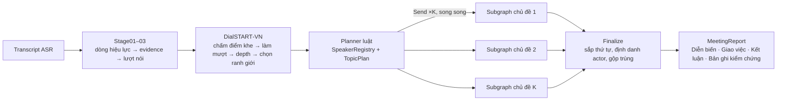
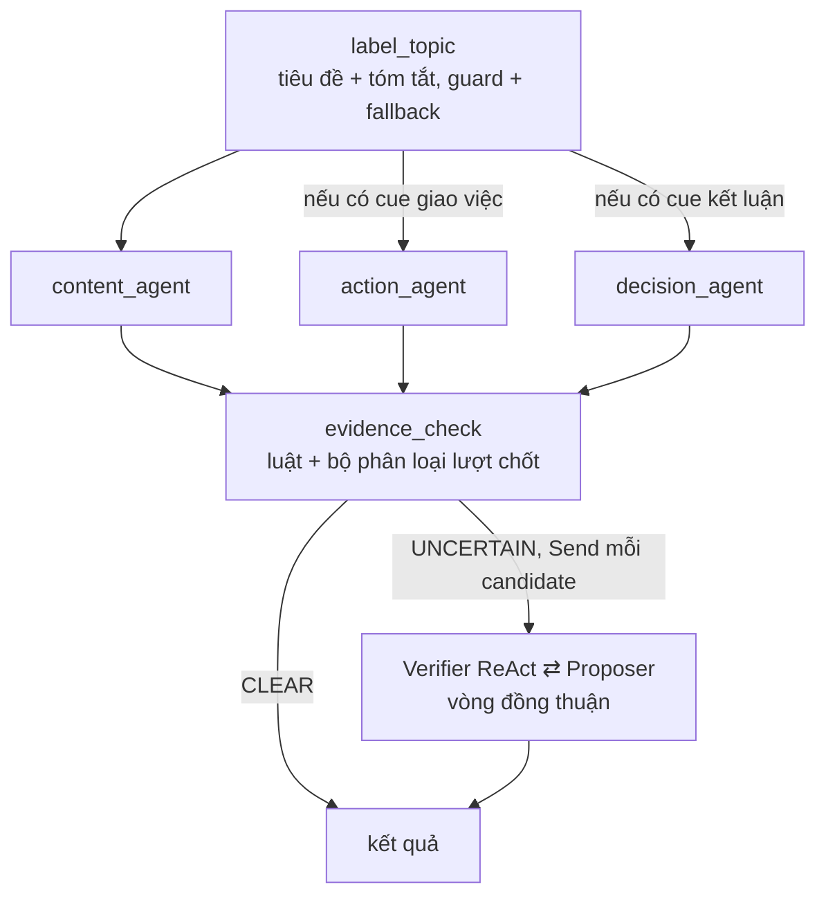

# DiVA: Cắt chủ đề hội thoại và đa tác tử có kiểm chứng đồng thuận để sinh biên bản họp tiếng Việt

*English title:* **DiVA: Dialogue Segmentation and Verified Agents for Grounded Vietnamese Meeting Minutes**

*Báo cáo phương pháp đề xuất (bản thảo), dự án `meeting_analysis`. Cập nhật: 12/10/2026.*

---

## Tóm tắt

Chúng tôi giải bài toán sinh biên bản họp có căn cứ từ bản ghi nhận dạng giọng nói (ASR) tiếng
Việt. Đầu ra gồm ba phần: **Diễn biến họp** (luận điểm của từng người nói theo chủ đề), **Giao
việc** (ai làm gì, hạn khi nào) và **Kết luận họp**. Cuộc họp hành chính thật thường dài (hơn
1.200 lượt nói, hơn 200 nghìn ký tự), nhiều chủ đề, nhiều người trùng tên, và hay giao việc
cho đơn vị thay vì cho cá nhân. Những đặc điểm này làm cách gọi một LLM trên toàn bản ghi vừa
đắt vừa khó kiểm chứng.

Phương pháp đề xuất, gọi là **DiVA** (*Dialogue segmentation + Verified Agents*), gồm hai thành phần
nối tiếp:

1. **DialSTART‑VN**: bộ cắt chủ đề dựa trên mạch lạc lượt‑cặp (DialSTART, Gao et al., 2023),
   huấn luyện lại trên backbone tiếng Việt. Chúng tôi thêm một bộ chọn ranh giới không cần
   biết trước số chủ đề: làm mượt điểm, ngưỡng depth thích nghi, sàn ký tự tỉ lệ theo độ dài
   cuộc họp, và trần ký tự cứng để mỗi đoạn vừa ngữ cảnh LLM.
2. **Agentic‑v3**: pipeline đa tác tử trên LangGraph, xử lý **mọi chủ đề song song** theo kiểu
   *map–reduce*. Một Planner dựa trên luật (0 token) dựng danh bạ người nói và bỏ các agent
   không cần thiết. Ba agent trích xuất sinh candidate kèm lượt nói làm căn cứ. Bộ lọc
   evidence‑check tách candidate chắc chắn khỏi candidate nghi ngờ. Candidate nghi ngờ được một
   **Verifier ReAct** kiểm, Verifier có công cụ chỉ đọc tra được cả cuộc họp. Sau đó Verifier
   và agent trích xuất trao đổi trong một **vòng đồng thuận** (accept / amend / defend) có
   ngân sách giới hạn và luật an toàn khi thất bại.

Trên dữ liệu hiện có, bộ chọn ranh giới nâng điểm tổng hợp của DialSTART trên gold thật từ
0,392 lên 0,637. Bỏ riêng bước làm mượt làm F1 giảm từ 0,418 xuống 0,297 trên 12 phiên Quốc hội.
Bộ phân loại hành vi lời nói của lượt chốt (dùng trong evidence‑check) đạt F1 0,894 so với
0,682 của luật từ khoá trên 869 lượt có nhãn, và ECE 0,040. Trên một cuộc họp thật 1.259 lượt và
14 chủ đề, toàn bộ pipeline chạy khoảng 78 giây, trong đó cắt chủ đề mất 12 giây. Chúng tôi chưa
có đánh giá chất lượng end‑to‑end trên gold. Mục 8 trình bày giao thức ablation dự kiến.

**Từ khoá:** dialogue topic segmentation, meeting summarization, action item extraction, LLM
agents, ReAct, multi-agent verification, tiếng Việt.

---

## 1. Giới thiệu

Biên bản họp của cơ quan hành chính có ba phần cố định: diễn biến, giao việc và kết luận. Soạn
tay mất nhiều giờ cho mỗi phiên. Với hệ thống tự động, sai sót đắt nhất là **sai về việc giao**:
bịa ra một nhiệm vụ không ai giao, gán nhầm người, hay ghi một đề xuất chưa được chấp nhận thành
kết luận. Vì vậy chúng tôi đặt yêu cầu **có căn cứ (grounded)** lên trước độ trôi chảy: mọi mục
đầu ra phải trỏ tới lượt nói thật trong bản ghi (`turn_id`). Riêng mục giao việc và kết luận phải
chỉ ra được lượt nói *giao/nhận* hoặc *chốt*.

Bản ghi ASR tiếng Việt thực tế có bốn khó khăn:

- **(K1) Độ dài và cấu trúc.** Một phiên có thể dài 5k–260k ký tự, gồm nhiều mục nghị sự. Gửi cả
  phiên vào một prompt vượt ngữ cảnh, hoặc làm suy giảm khả năng chú ý tới chi tiết.
- **(K2) Khoảng cách giữa dữ liệu huấn luyện và dữ liệu thật trong cắt chủ đề.** Hội thoại tổng
  hợp ghép nối thì dễ cắt, cuộc họp thật cùng một dự án, cùng từ vựng, cùng người nói thì khó.
  Ngoài ra, ít nhất 49,5% lượt phát biểu của đại biểu Quốc hội chứa nhiều chủ đề (Mục 6.1), nên
  ranh giới theo lượt nói luôn có sai số nội tại.
- **(K3) Định danh tác nhân.** Người giao việc gọi "anh Sơn" khi cuộc họp có hai người tên Sơn.
  Việc hay được giao cho đơn vị ("Sở Tài chính chủ trì, phối hợp Sở Xây dựng"). Đại từ "em",
  "bên em" phải quy về người hoặc đơn vị cụ thể.
- **(K4) Hành vi lời nói mơ hồ.** Lời giao việc thường ở dạng khẩu ngữ ("anh Phong gửi giúp em
  trong tuần này được không ạ?"). "Đề nghị" của chủ trì là chỉ đạo, còn của đại biểu chỉ là kiến
  nghị. Luật từ khoá bỏ sót nhiều trường hợp và gắn cờ nhầm.

Phiên bản trước của hệ thống (v1) xử lý chủ đề **tuần tự**. Lý do là để chuyển ngữ cảnh
`known_names` sang chủ đề sau. Kiểm chứng ở v1 dùng *Debate + Judge* (3 lời gọi nối tiếp, chỉ đọc
đoạn hiện tại). Hệ quả là thời gian tăng tuyến tính theo số chủ đề, và Judge không thấy được lượt
chốt nằm ở chủ đề khác.

**Đóng góp.**

1. **C1 – Cắt chủ đề không cần oracle cho cuộc họp tiếng Việt.** Chúng tôi huấn luyện DialSTART
   trên backbone `vibert4news`, tăng tốc suy luận bằng cách mã hoá mỗi lượt một lần rồi dùng tổng
   tích luỹ, và đề xuất bộ chọn ranh giới bốn bước có ràng buộc ký tự (Mục 4.2).
2. **C2 – Kiến trúc map–reduce cho phân tích biên bản.** Ngữ cảnh chạy dồn được thay bằng một
   *SpeakerRegistry* dựng một lần, nên các chủ đề trở nên độc lập. Độ trễ không còn tăng tuyến
   tính theo số chủ đề (Mục 4.3–4.4).
3. **C3 – Kiểm chứng chọn lọc nhiều tầng.** Tầng một là luật (0 token). Tầng hai là bộ phân loại
   hành vi lời nói đã hiệu chỉnh xác suất. Tầng ba là Verifier ReAct với công cụ tra cả cuộc họp.
   LLM đắt chỉ được gọi cho candidate thật sự nghi ngờ (Mục 4.5–4.6).
4. **C4 – Giao thức đồng thuận Verifier ⇄ Proposer.** Giao thức có ba lập trường, thứ tự trường
   JSON buộc mô hình *chỉ ra bằng chứng trước khi kết luận*, và bảng kết thúc an toàn: lỗi hạ tầng
   không bao giờ xoá nội dung đã trích (Mục 4.7).
5. **C5 – Định danh tác nhân có thể giải thích.** Ứng viên người hoặc đơn vị được chấm điểm theo
   tên, ngữ cảnh rồi chức năng, có tách nhiều bên nhận việc kèm vai trò chủ trì / phối hợp
   (Mục 4.6).

---

## 2. Công trình liên quan

**Cắt chủ đề hội thoại.** TextTiling (Hearst, 1997) đặt nền cho cách tính *depth score* trên chuỗi
độ tương đồng giữa hai cửa sổ. TreeSeg (Gklezakos et al., 2024) phân cụm chia dần trên embedding
để dựng cây phân hoạch. DialSTART (Gao et al., 2023) mở rộng hướng chấm mạch lạc lượt‑cặp (Xing & Carenini, 2021), học không
giám sát hai tín hiệu: *mạch lạc* lượt‑cặp qua đầu NSP, và *tương đồng chủ đề* qua đối sánh tương phản trên phân đoạn giả. Gần đây có
các hướng dùng LLM, như phân loại ý định từng lượt (Def‑DTS) và sinh mục lục nhiều tầng. Kết quả
của các hướng này cho thấy zero‑shot còn cách xa bản fine‑tune. Phân tích "When F1 Fails" chỉ ra
rằng việc chọn ngưỡng (độ mịn) ảnh hưởng tới điểm nhiều hơn việc chọn phương pháp. Đây là động lực
để chúng tôi thiết kế bộ chọn ranh giới riêng thay vì dùng số ranh giới oracle.

**Trích xuất từ cuộc họp.** Các nghiên cứu trên AMI và ICSI (Carletta et al., 2005; Janin et al.,
2003) về phát hiện action item (Purver et al., 2007) và tóm tắt hướng truy vấn QMSum (Zhong et al.,
2021) chủ yếu dùng tiếng Anh và ít đòi hỏi trích dẫn tới từng lượt. Bài toán của chúng tôi yêu cầu
mỗi mục phải có lượt nói làm căn cứ, chuẩn hoá hạn chót về ngày, và định danh đơn vị.

**Tác tử LLM và tự kiểm chứng.** ReAct (Yao et al., 2023) xen kẽ suy nghĩ và hành động công cụ.
Plan‑and‑Solve (Wang et al., 2023) tách bước lập kế hoạch khỏi bước thực thi. Tranh luận đa tác tử
(Du et al., 2023; Liang et al., 2023), Self‑Refine (Madaan et al., 2023) và CRITIC (Gou et al., 2024)
dùng phản hồi để sửa đầu ra. Agentic‑v3 kết hợp ba ý tưởng: Planner dựa trên luật thay cho Planner
LLM, Verifier ReAct chỉ đọc, và vòng phản hồi có *hai bên* với luật hậu kiểm tất định. Khác với
tranh luận tự do, mỗi lượt trong giao thức của chúng tôi phải neo vào một `turn_id` có thật.

---

## 3. Định nghĩa bài toán

Đầu vào là bản ghi $\mathcal{T} = (u_1, \dots, u_n)$. Mỗi lượt nói $u_i = (\text{id}_i, s_i, x_i)$ gồm
mã lượt, người nói và nội dung. Kèm theo có thể có ngày họp $d$, tên người chủ trì $c$ và danh sách
tham dự $\mathcal{R}$ (người: họ tên, chức vị, đơn vị; đơn vị: tên, tên gọi tắt, chức năng).

**Cắt chủ đề.** Tìm tập ranh giới $B = \{b_1 < \dots < b_{K-1}\} \subset \{1,\dots,n-1\}$. Ranh giới
$b$ nghĩa là đoạn mới bắt đầu ở lượt $b$. Kết quả là $K$ đoạn liền mạch $S_1,\dots,S_K$. Mọi đoạn
phải thoả trần ký tự $|S_k|_{\text{char}} \le L_{\max}$ (mặc định $35.000$), trừ khi một lượt đơn lẻ
đã dài hơn trần.

**Trích xuất.** Với mỗi đoạn $S_k$, sinh:

- $\mathcal{D}_k$: các luận điểm $(s, \text{text}, E)$ với $E \subseteq \text{ids}(S_k)$;
- $\mathcal{A}_k$: các việc giao $(\text{actor}, \text{type}, \text{text}, \text{deadline}, d^\*, \kappa, E, t^\*)$.
  Ở đây $\text{type} \in \{\text{person}, \text{organization}, \text{unknown}\}$, $d^\*$ là ngày chuẩn
  hoá, $\kappa \in \{\text{exact}, \text{before}, \text{end\_of\_period}, \text{relative}, \text{unknown}\}$,
  và $t^\*$ là *lượt giao/nhận*;
- $\mathcal{C}_k$: các kết luận $(\text{text}, E, t^\*)$, với $t^\*$ là *lượt chốt*.

**Ràng buộc căn cứ.** Mọi $E$ chỉ chứa `turn_id` thật. Câu trích chỉ được giữ nếu là chuỗi con thật
của lượt nói. Một việc giao hoặc kết luận được giữ sau kiểm chứng chỉ khi $t^\*$ tồn tại trong cuộc
họp. $t^\*$ có thể nằm ở chủ đề khác.

---

## 4. Phương pháp

### 4.1. Tổng quan



Mỗi subgraph chủ đề chạy như sau:



Tiền xử lý (stage01–03) áp bản sửa của người duyệt lên ASR, "đóng băng" từng dòng thành
`EvidenceItem` có mã ổn định và băm nội dung, rồi gộp thận trọng các dòng liên tiếp cùng người nói
thành lượt nói. Gộp chỉ xảy ra khi cùng người nói đã xác định, cùng vai trò và khoảng cách ≤ 5 s.
Lượt nói là đơn vị nhỏ nhất cho cả cắt chủ đề lẫn trích dẫn.

### 4.2. DialSTART‑VN: cắt chủ đề dựa trên mạch lạc

#### 4.2.1. Mô hình

`SegModel` có hai bộ mã hoá BERT, cùng khởi tạo từ `NlpHUST/vibert4news-base-cased` (từ vựng
62.000):

- **Nhánh chủ đề** $f_\theta$: pooled output của một lượt, dùng làm embedding chủ đề $\mathbf{e}_i$.
- **Nhánh mạch lạc** $g_\phi$: BERT có đầu NSP, nhận cặp (ngữ cảnh trái, lượt kế tiếp) và trả logit
  "liền mạch" $\ell$.

Với khe $g$ (giữa $u_g$ và $u_{g+1}$) và cửa sổ $w = 2$:

$$
\text{score}(g) = \sigma\Big(\ell\big([u_{g-w+1..g}]_{\texttt{[SEP]}},\ u_{g+1}\big) + \cos\big(\bar{\mathbf{e}}_{g-w+1..g},\ \bar{\mathbf{e}}_{g+1..g+w}\big)\Big)
$$

trong đó $\bar{\mathbf{e}}$ là trung bình embedding trong cửa sổ. Điểm thấp nghĩa là khe dễ là ranh
giới.

**Huấn luyện** theo DialSTART, trên hội thoại tiếng Việt tổng hợp (`vn_synth`). Hàm mất mát gồm hai
phần:

$$
\mathcal{L} = \underbrace{\max\big(0,\ m - (s^+ - s^-)\big)}_{\text{margin ranking trên cặp dương/âm}} + \mathcal{L}_{\text{topic}},
$$

với $s^{\pm} = \ell^{\pm} + \cos^{\pm}$ và $m = 1$. $\mathcal{L}_{\text{topic}}$ là margin tương phản
trên **phân đoạn giả**. Cách dựng phân đoạn giả: tính depth (TeT) trên độ tương đồng chủ đề và lấy 5
khe sâu nhất làm ranh giới giả. Sau đó, với mỗi lượt neo, các lượt cùng đoạn giả là dương và các
lượt ngoài đoạn là âm.

**Mã hoá giống lúc huấn luyện.** Bộ đánh giá gốc cắt mỗi lượt còn 128 ký tự. Khi suy luận, chúng tôi
giữ cả lượt (tối đa 256 token) cho nhánh chủ đề, và giữ 256 token **cuối** của ngữ cảnh trái (phần sát
khe) cho NSP. Lý do: khoảng 1/3 số lượt trong cuộc họp thật dài hơn 128 ký tự.

**Tăng tốc suy luận.** Pooled output không phụ thuộc padding (đã có attention mask), nên mỗi lượt
chỉ cần mã hoá **một lần**. Trung bình cửa sổ được tính bằng tổng tích luỹ
$\mathbf{P}_j = \sum_{i<j}\mathbf{e}_i$, mỗi khe tốn $O(1)$. Cách này nhanh hơn khoảng $2w$ lần so
với mã hoá lại cửa sổ cho từng khe. Câu được gom batch theo độ dài với trần
$|\text{batch}| \times \max\text{len} \le 4096$ token, để lượt dài không làm tràn GPU nhỏ.

#### 4.2.2. Chọn ranh giới không cần oracle

Bộ đánh giá DialSTART gốc dùng **số ranh giới thật** (oracle). Khi chạy thật thì không có số này.
Chúng tôi đề xuất quy trình sau:

1. **Làm mượt** bằng trung bình trượt, cửa sổ 3 khe căn giữa, để lấp các chỗ trũng giả do câu xen
   ngang ("Vâng", "Mời anh…").
2. **Depth score** kiểu TextTiling: $\text{depth}(g) = \tfrac12\big(\text{peak}_L(g) + \text{peak}_R(g) - 2\,\text{score}(g)\big)$.
   $\text{peak}_L$ và $\text{peak}_R$ có được bằng cách leo đơn điệu sang trái và sang phải tới đỉnh gần nhất.
3. **Bộ chọn bốn bước** (`select_boundaries`):

```
Thuật toán 1: SELECT-BOUNDARIES(depth, chars, emb)
  τ ← mean(depth) + α·std(depth)                       ▷ α = 1.0
  E ← {0, n}
  for g in argsort(depth, giảm dần) while depth[g] > τ:   ▷ (a) ngưỡng
      if hai phía của g+1 đều ≥ m_min lượt: E ← E ∪ {g+1}   ▷ m_min = 4
  while đoạn ngắn nhất < C_min ký tự:                   ▷ (b) bỏ đoạn vụn
      xoá mép (trong 2 mép của đoạn đó) có depth thấp hơn
  [tuỳ chọn] while max cos(đoạn kề) ≥ β và gộp ≤ L_max:  ▷ (c) gộp đoạn giống
      gộp cặp kề có cos(embedding trung bình) cao nhất
  for đoạn có ký tự > L_max:                           ▷ (d) tách đoạn quá dài
      tách tại khe depth cao nhất bên trong (ưu tiên khe giữ ≥ m_min lượt mỗi bên), lặp
  return E \ {0, n}
```

Sàn ký tự **tỉ lệ theo độ dài cuộc họp**:
$C_{\min} = \operatorname{clip}\big(\lfloor \sum_i |u_i| / 15 \rfloor,\ 1500,\ 10000\big)$.
Nhờ vậy cùng một cấu hình chạy được cho cả cuộc họp 5k ký tự lẫn 260k ký tự. Độ dài dùng cho mọi
ràng buộc ký tự được đo trên dòng `"người nói: nội dung"`, chính là chuỗi sẽ vào prompt LLM. Riêng
văn bản đưa vào mô hình thì **không** kèm tên người nói, giống dữ liệu huấn luyện. Bước (c) hiện tắt
trong cấu hình chạy ($\beta = \text{None}$). Bước (d) là ràng buộc cứng phục vụ các agent phía sau.

### 4.3. Planner dựa trên luật (Plan‑and‑Execute, 0 token)

Planner chạy **một lần** trước khi tách song song:

- **SpeakerRegistry**: danh sách tên người nói không trùng của cả cuộc họp (theo thứ tự xuất hiện),
  cộng danh sách tham dự $\mathcal{R}$ nếu có. Danh bạ này thay ngữ cảnh `known_names` chạy dồn của
  v1. Khác v1 ở hai điểm: danh bạ thấy cả người chỉ xuất hiện ở chủ đề *sau*, và tên do agent tự gán
  (có thể sai) không còn lan sang chủ đề khác.
- **TopicPlan**: với đoạn $S_k$, chạy Action agent khi văn bản (đã chuẩn hoá NFC, chữ thường) chứa ít
  nhất một cụm trong $\mathcal{Q}_A$ (≈ 33 cụm: "giao", "phụ trách", "sẽ", "trước ngày"…). Chạy
  Decision agent khi chứa ít nhất một cụm trong $\mathcal{Q}_C$ (≈ 22 cụm: "chốt", "thống nhất",
  "kết luận"…). Cụm phải khớp trọn âm tiết. Bộ cue được chọn **rộng** một cách có chủ đích: bỏ nhầm
  làm mất recall, còn chạy thừa chỉ tốn một lời gọi. Content agent không bao giờ bị bỏ. Mọi agent bị
  bỏ được ghi vào `skipped_agents` để có thể đo recall.

### 4.4. Xử lý song song theo chủ đề

Graph cha phát `Send("topic", S_k)` cho **mọi** $k$ cùng lúc. Mỗi gói mang theo các lượt của đoạn,
toàn bộ lượt của cuộc họp (dùng cho công cụ Verifier), danh bạ và kế hoạch. Gán nhãn chủ đề (stage07:
LLM đề xuất tiêu đề và tóm tắt, guard tất định kiểm tên riêng và cụm chung chung, thử lại, fallback)
nằm *trong* subgraph. Nhờ vậy chủ đề nào có nhãn trước thì trích xuất ngay.

Ba nhánh trích xuất nối thẳng vào `evidence_check`, không dùng join chờ đủ ba. Mọi nhánh cách điểm
phân nhánh đúng một bước, nên LangGraph ghi kết quả trong cùng một *superstep* và `evidence_check`
chạy đúng một lần dù số nhánh thay đổi theo kế hoạch. Các khoá kết quả được cộng dồn bằng reducer
`operator.add`. `finalize` sắp lại kết quả theo thứ tự chủ đề vì thứ tự hoàn thành không xác định,
quy actor về tên người nói khi khớp duy nhất, rồi gộp việc giao hoặc kết luận trùng giữa các chủ đề.

**Mô hình chi phí.** Gọi $N$ là số chủ đề, $N_A, N_C \le N$ là số chủ đề chạy Action/Decision, $M$ là
số candidate nghi ngờ, $R$ là số vòng đồng thuận tối đa, $T$ là số lần gọi công cụ tối đa mỗi vòng.

| | v1 | Agentic‑v3 |
|---|---|---|
| Lời gọi trích xuất | $3N$ | $N + N_A + N_C$ |
| Lời gọi kiểm chứng | $3M$ (debate + judge) | $\sum_{m=1}^{M} c_m,\ \ c_m \le R\,(T+2)$ (mặc định $\le 15$) |
| Đường găng độ trễ | $\sum_k t_k$ (tuần tự) | $\max_k t_k$ (bị chặn bởi cổng đồng thời) |

Mỗi vòng tốn tối đa $T+1$ lời gọi Verifier và 1 lời gọi Proposer. Thực tế Verifier thường kết luận
sau 1–2 lời gọi. Số lời gọi LLM đồng thời thật sự do một `LLMConcurrencyGate` quyết định: đây là
`BoundedSemaphore` dùng chung cả tiến trình, bọc mọi adapter, mặc định 8. Verifier có thể có cổng
riêng khi trỏ tới backend khác.

### 4.5. Agent trích xuất và evidence‑check

**Agent trích xuất** dùng lại node của v1 (giữ phần làm sạch output) nhưng với system prompt riêng
của v3. Các quy tắc chính:

- *Bằng chứng trước*: chọn `evidence_turn_ids` trước khi viết `text`.
- *Ngôi thứ ba*: không dùng đại từ trần trụi, không đoán tên.
- *Quy tắc chủ trì* (`CHAIR_ASSIGNMENT_RULE`): khi người chủ trì nói "đề nghị/yêu cầu/giao + người/đơn
  vị + việc" thì đó là **giao việc**, kể cả khi không có chữ "giao". Cùng câu đó do thành viên khác
  nói thì chỉ là đề xuất.
- *Khai trung thực*: nhãn `proposed`/`reported` chỉ dùng khi **không chắc**. Chắc là đề xuất chưa ai
  nhận hoặc là báo cáo tiến độ thì không đưa vào. Lý do: mỗi mục nghi ngờ tốn vài lời gọi Verifier.
- *Chuẩn hoá hạn*: neo theo ngày họp, theo bộ quy ước tường minh (tuần kết thúc Chủ nhật; "tháng
  sau" là ngày cuối tháng kế; "A hoặc B" lấy mốc muộn hơn…). Có module luật dự phòng khi LLM trả sai
  định dạng.

Người chủ trì (nếu có) được nêu ở dòng đầu user prompt. Lỗi LLM được thử lại **tại chỗ**
(`extract_attempts = 2`) thay vì đợi tới sau chủ đề cuối như v1.

**Evidence‑check** (0 token, hoặc một lời gọi phân loại rẻ cho mỗi lượt chốt) tách candidate thành
CLEAR (vào kết quả ngay) và UNCERTAIN (gửi Verifier kèm lý do). Một **việc giao** bị gắn cờ khi:

- actor rỗng hoặc không định danh được ("nhóm", "một thành viên");
- actor không có căn cứ trong bản ghi hoặc danh bạ. Từ chỉ vai trò ("chủ trì", "phối hợp với") được
  bỏ trước khi kiểm;
- lượt chốt không mang hành vi giao/nhận;
- actor khớp ≥ 2 ứng viên mà không ai đủ rõ, ví dụ hai người tên Sơn. Trường hợp này vẫn gửi Verifier
  dù luật v1 coi là CLEAR.

Một **kết luận** bị gắn cờ khi lượt chốt không phải lời chốt, hoặc có dấu hiệu rào đón.

**Bộ phân loại hành vi lời nói của lượt chốt** (tuỳ chọn) thay luật từ khoá
`_COMMIT_CUES`/`_HEDGE_CUES`. Đầu vào là lượt cần xét kèm 2 lượt ngữ cảnh (cắt 2.500 ký tự mỗi lượt).
Đầu ra là phân bố trên 6 nhãn: {giao_viec, ket_luan, de_xuat, bac_bo, thao_luan, khac}. Xác suất chốt
$p = P(\text{giao\_viec}) + P(\text{ket\_luan})$ chia quyết định thành ba vùng:

$$
\text{flag}(p) =
\begin{cases}
\text{không gắn cờ} & p \ge 0{,}8 \\
\text{"chưa rõ" kèm phân bố} & 0{,}2 \le p < 0{,}8 \\
\text{"không phải lời chốt"} & p < 0{,}2
\end{cases}
$$

Khi API lỗi hoặc quá thời gian chờ, hệ thống quay về luật từ khoá. Ngưỡng được chọn trên tập tổng hợp
(Mục 6.2).

### 4.6. Định danh tác nhân (luật, có giải thích)

Với mỗi cách gọi (mention), hệ thống chấm điểm ứng viên theo ba tầng ưu tiên:

1. **Tên.** Khớp họ tên, tên đơn vị, tên gọi tắt hoặc tên người nói: 1,0. Khớp một phần tên đơn vị:
   0,7. Khớp tên gọi: 0,6. Có dạng tên đơn vị nhưng không có trong danh sách: 0,6.
2. **Ngữ cảnh quanh lượt chốt** (ưu tiên). Người nói ngay sau lượt chốt được +0,3 vì thường là người
   nhận việc. Người giao việc ở lượt chốt bị −0,3, vì không ai tự gọi mình là "anh Sơn". Với việc tự
   nhận thì người nói được +0,3.
3. **Chức năng** (chỉ khi ngữ cảnh chưa phân định). +0,1 cho mỗi âm tiết nội dung của việc trùng với
   chức vị, đơn vị hoặc `functions`, tối đa +0,3.

Ứng viên được coi là **rõ ràng** khi $\text{score}_1 \ge 0{,}6$ và $\text{score}_1 - \text{score}_2 \ge 0{,}2$.
Nếu không, hệ thống đặt `actor_type = unknown` và `actor_flag = ambiguous`, giữ danh sách ứng viên
kèm điểm, và **vẫn giữ việc giao**.

Actor ghép được tách thành nhiều bên kèm vai trò `lead` / `support` / `joint`. Ví dụ "Sở Tài chính
chủ trì, phối hợp với Sở Xây dựng" cho Sở Tài chính là `lead` và Sở Xây dựng là `support`. Tên đơn vị
được chuẩn hoá trước khi so khớp: "UBND TP", "Ủy ban nhân dân Thành phố" và "UBND Thành phố" là một,
còn HĐND vẫn khác UBND. Tên trong danh sách chứa chữ "và" không bị cắt đôi.

### 4.7. Verifier ReAct và vòng đồng thuận

**Verifier.** ReAct được dựng trên giao diện `generate_json` (một lượt hỏi–đáp JSON), nên **không
cần provider hỗ trợ tool calling**. Mỗi lượt, mô hình trả về:

```json
{"thought", "action": "get_turn|search_meeting|lookup_speaker|final", "argument",
 "deciding_turn_id", "verdict": "keep|revise|drop|unresolved",
 "revised_actor", "revised_actor_type", "actor_reason", "reasoning"}
```

Ba công cụ đều **chỉ đọc**. Lỗi công cụ được trả lại dưới dạng observation để Verifier tự sửa,
không ném ngoại lệ.

| Công cụ | Chức năng |
|---|---|
| `get_turn(id)` | Nguyên văn một lượt bất kỳ trong **cả cuộc họp** |
| `search_meeting(q)` | Top‑$k$ ($k=5$) lượt khớp nhất. Điểm BM25 ($k_1 = 1{,}2$, $b = 0{,}75$) trên âm tiết nội dung và cặp âm tiết, cặp âm tiết có trọng số ×2. Kết quả cắt quanh chỗ khớp |
| `lookup_speaker(mention[@id])` | Ứng viên người/đơn vị kèm điểm, lý do và nhãn RÕ RÀNG/MƠ HỒ (Mục 4.6) |

Có ba quyết định thiết kế đáng chú ý:

- **Thứ tự trường như một ràng buộc suy luận.** Mô hình sinh JSON theo thứ tự trường, và
  `deciding_turn_id` đứng **trước** `verdict`. Vì vậy mô hình phải chỉ ra lượt giao/chốt trước khi kết
  luận, thay vì chọn nhãn rồi tìm bằng chứng cho khớp.
- **Cờ của bộ lọc là gợi ý, không phải bằng chứng.** Prompt nói rõ cờ không được dùng làm lý do bỏ
  candidate. Trước khi kết luận `drop`, Verifier phải đọc các lượt của người chủ trì, nhất là các lượt
  tổng kết cuối đoạn.
- **Ngân sách và chống lặp.** Mỗi vòng có tối đa $T+1$ lời gọi, lượt cuối bắt buộc `final`. Gọi lại y
  hệt một công cụ đã gọi thì công cụ không chạy, hệ thống chỉ báo lặp.

**Luật hậu kiểm** (tất định): `keep`/`revise` mà không có `deciding_turn_id` thuộc cuộc họp thì bị hạ
thành `drop`. `revise` chỉ được nhận nếu actor định danh được. Lựa chọn actor của Verifier phải trùng
tên một ứng viên mà công cụ đã trả về và phải kèm `actor_reason`, nếu không hệ thống quay về kết quả
của luật. Khác v1, lượt chốt **được phép nằm ở chủ đề khác**.

**Vòng đồng thuận.** Giao thức này thay cho bước duyệt người:

```
Thuật toán 2: VERIFY-WITH-CONSENSUS(x₀)
  x ← x₀; H ← []
  for r = 1..R:
      (v, t*, x̂, fb) ← ReAct-Verifier(x, H)          ▷ có thể lỗi → FALLBACK(x₀)
      if v = keep:  return (x̂, consensus)
      (σ, t_p, arg) ← Proposer(x, v, fb, observations, H)   ▷ σ ∈ {accept, amend, defend}
      if σ = accept và t_p hợp lệ và v ≠ revise:  σ ← defend   ▷ tự mâu thuẫn
      H ← H ∪ {(x, steps, v, fb, t*, σ, arg, t_p)}
      if σ = accept:  return (x̂ nếu v = revise, ngược lại DROP; consensus)
      if σ = amend:   x ← bản sửa (chỉ nhận nếu t_p là lượt thật, actor định danh được)
      # defend: giữ x, vòng sau Verifier xét lại kèm lập luận
  if v = unresolved: return (x₀, fallback)
  return (theo kết luận cuối của Verifier, verifier)
```

| Tình huống | Kết quả | `decided_by` |
|---|---|---|
| Đồng thuận | keep/revise thì giữ, drop thì bỏ | `consensus` |
| Hết vòng, Verifier đã có kết luận | theo kết luận cuối của Verifier | `verifier` |
| Hết vòng, Verifier vẫn `unresolved` | giữ candidate **gốc** | `fallback` |
| Lỗi LLM ở bất kỳ bước nào | giữ candidate **gốc** | `fallback` |

Có hai nguyên tắc an toàn. Thứ nhất, lỗi hạ tầng không được xoá nội dung đã trích. Thứ hai, bản do
agent tự sửa mà Verifier chưa xét lại thì không được vào kết quả. Verifier được dặn xét lập luận của
agent *trên bản ghi* và không nhượng bộ chỉ vì bị phản biện. Mọi vòng đều được lưu trong
`VerificationRecord.rounds` để kiểm toán, và giao diện có bộ lọc "Chưa đồng thuận".

Với Proposer, trường văn bản tự do `argument` được đặt **cuối** schema. Chúng tôi quan sát thấy một mô
hình mở (gemma) sinh khoảng trắng vô tận khi sau trường tự do vẫn còn trường bắt buộc. Prompt cũng giới
hạn `argument` ≤ 2 câu và cấm dấu nháy kép để tránh JSON hỏng.

---

## 5. Thiết lập thực nghiệm

### 5.1. Dữ liệu

| Tập | Mô tả | Dùng cho |
|---|---|---|
| `vn_synth` (train/val/test) | Hội thoại tiếng Việt tổng hợp, ghép các đoạn có nhãn ranh giới | Huấn luyện và chọn checkpoint DialSTART (`model_vn3`) |
| Quốc hội khoá XIII | 47 phiên có ground truth chủ đề (`*_groundtruth.docx`), trong đó 12 phiên dùng để đo cắt chủ đề | Đo độ thuần chủ đề của lượt nói; ablation bộ chọn ranh giới |
| Gold thật (`007_dialtreeseg/gold`) | 3 cuộc họp hành chính, ranh giới đã duyệt | Tinh chỉnh tham số cắt |
| `eval/synthetic` | 30 transcript tổng hợp; 869 lượt có nhãn hành vi lời nói (484 dương, 385 âm) | Tinh chỉnh cắt; đo bộ phân loại lượt chốt |
| `bien-ban-tong-hop-v1` | Cuộc họp thật, 1.259 lượt, 14 chủ đề sau cắt | Đo thời gian end‑to‑end |

### 5.2. Độ đo

- **Cắt chủ đề:** $P_k$ và WindowDiff (segeval); F1 ranh giới theo dung sai ký tự (F1@2k, F1@5k); điểm
  tổng hợp $S = \tfrac14\big(\text{F1@2k} + \text{F1@5k} + 2 - 2P_k\big)$; $|\Delta K|$.
- **Lượt chốt:** Precision, Recall, F1 so với nhãn gold "đã chốt/giao"; Expected Calibration Error
  (ECE, 10 bin).
- **Hiệu năng:** thời gian thực end‑to‑end; số lời gọi LLM.

### 5.3. Cấu hình

| Thành phần | Cấu hình |
|---|---|
| DialSTART | `vibert4news-base-cased` ×2; $w=2$; max_len 512; làm mượt 3; $\alpha = 1{,}0$; $m_{\min} = 4$; $C_{\min} = \text{clip}(L/15, 1500, 10000)$; $L_{\max} = 35.000$ |
| Gán nhãn chủ đề, 3 agent trích xuất, Proposer | gemma (máy chủ riêng, giao diện OpenAI‑compatible) |
| Verifier | `gpt-4o-mini`, `json_schema` strict |
| Phân loại lượt chốt | OpenAI Decisions API (`TURN_ACT_MODEL`), timeout 10 s |
| V3Config | `skip_agents_without_cues=True`, `extract_attempts=2`, `verifier_max_tool_calls=3`, `search_top_k=5`, `consensus_max_rounds=3`, `max_concurrency=16`; cổng LLM 8 |

---

## 6. Kết quả

> **Ghi chú trung thực.** Các con số dưới đây được tổng hợp từ các thí nghiệm thành phần của dự án,
> chạy ở các thời điểm khác nhau và trên các tập khác nhau. Chúng **không** cùng một bảng so sánh có
> kiểm soát. Hiện chưa có đánh giá chất lượng end‑to‑end (Giao việc / Kết luận) trên gold.

### 6.1. Cắt chủ đề

**Giới hạn của việc cắt theo lượt nói.** Trên 47 phiên Quốc hội, chặn dưới bảo thủ (pigeonhole) của tỉ
lệ lượt nói chứa nhiều chủ đề là 49,8% trên mọi vai trò và **49,5%** khi chỉ tính đại biểu (541/1.092
cặp người nói–phiên). Có 43/47 phiên chứa ít nhất một lượt đa chủ đề. Như vậy mọi bộ cắt theo lượt nói,
kể cả DialSTART‑VN, đều có một trần sai số nội tại trên dạng dữ liệu này.

**Khoảng cách tổng hợp → thật và vai trò của bộ chọn ranh giới.**

| Cấu hình | Dữ liệu | Kết quả |
|---|---|---|
| DialSTART `model_vn3`, số ranh giới oracle | val tổng hợp | $P_k = 0{,}011$ |
| DialSTART `model_vn3`, chưa có bộ chọn | gold thật | $P_k = 0{,}485$, cắt quá vụn |
| DialSTART + bộ chọn (bộ tham số cũ) | gold thật / tổng hợp | $S = 0{,}392$ / $0{,}336$ |
| **DialSTART + bộ chọn (đề xuất)** | gold thật / tổng hợp | $S = \mathbf{0{,}637}$ / $\mathbf{0{,}686}$ |

Tương quan Spearman giữa điểm trên tập tổng hợp và trên gold thật chỉ là 0,56. Vì vậy khi tinh chỉnh,
chúng tôi ưu tiên gold thật.

**Ablation bộ chọn ranh giới** (12 phiên Quốc hội có nhãn):

| Biến thể | F1 |
|---|---|
| Đầy đủ (có làm mượt) | 0,418 |
| Bỏ bước làm mượt | 0,297 (−0,121) |
| Thêm bước gộp đoạn giống nhau (c) | +0,025 |

Làm mượt là bước có tác động lớn nhất.

**Đối chiếu với các hướng khác đã thử trong dự án** (tham khảo, khác tập và khác thời điểm):

| Phương pháp | Kết quả |
|---|---|
| TreeSeg theo câu (12 cuộc họp) | F1 0,26–0,37, không vượt mốc chia đều 0,346 |
| LLM (gemma‑4‑26B) chia trên tóm tắt cụm | $P_k$ 0,48–0,56, cắt vụn cả ở phiên chỉ có 1 chủ đề |
| DialTreeSeg (DialSTART quyết định *có* tách, TreeSeg quyết định tách *ở đâu*) | $P_k$ 0,224; F1@5k 0,486; 8/9 phiên đạt $|\Delta K| \le 2$ |

DialTreeSeg vẫn được giữ làm phương án thay thế (`TOPIC_SEGMENTER=dialtreeseg`). Lựa chọn mặc định
DialSTART‑VN có ba ưu điểm: không gọi dịch vụ embedding ngoài (lời gọi embedding là bước duy nhất
trong pipeline không có dự phòng khi lỗi), chỉ dùng một mô hình, và nhanh (12 s cho 1.259 lượt).

### 6.2. Bộ phân loại lượt chốt trong evidence‑check

Kết quả trên 869 lượt có nhãn của `eval/synthetic` (tái tạo bằng `experiments/009_decisions_api/analyze.py`):

| Phương pháp | P | R | F1 |
|---|---|---|---|
| Luật từ khoá (v1) | 0,774 | 0,610 | 0,682 |
| Decisions, $p \ge 0{,}3$ | 0,813 | 0,959 | 0,880 |
| Decisions, $p \ge 0{,}5$ | **0,863** | **0,928** | **0,894** |
| Decisions, $p \ge 0{,}8$ | 0,923 | 0,816 | 0,866 |
| Decisions, $p \ge 0{,}9$ | 0,939 | 0,738 | 0,826 |

ECE = 0,040. Độ trễ p50 là 0,30 s và p95 là 0,41 s. Phân bố theo ba vùng quyết định:

| Vùng $p$ | Số lượt | Tỉ lệ thật sự là chốt | Xử lý |
|---|---|---|---|
| $[0;\ 0{,}2)$ | 267 | 0,04 | gắn cờ "không phải lời chốt" |
| $[0{,}2;\ 0{,}8)$ | 174 | 0,45 | gửi Verifier |
| $[0{,}8;\ 1]$ | 428 | 0,92 | CLEAR |

Như vậy chỉ 20% số lượt rơi vào vùng thật sự mơ hồ (tỉ lệ dương ≈ 0,45) và cần tới Verifier. Đây chính
là điều kiện để kiến trúc kiểm chứng chọn lọc tiết kiệm chi phí.

Phân tích theo loại lượt (tỉ lệ bị coi là "đã chốt", regex | Decisions $p \ge 0{,}5$):

| Loại lượt (gold) | n | Regex | Decisions |
|---|---|---|---|
| assignment | 338 | 0,51 | 0,91 |
| decision | 106 | 0,85 | 0,94 |
| assignment+decision | 40 | 0,82 | 1,00 |
| other (âm) | 240 | 0,26 | 0,18 |
| hedged_proposal (âm) | 90 | 0,09 | 0,11 |
| unassigned_task (âm) | 36 | 0,22 | 0,31 |
| rejected_task (âm) | 9 | 0,22 | 0,11 |
| superseded_decision | 10 | 0,50 | 0,50 |

Lợi ích lớn nhất nằm ở lời **giao việc khẩu ngữ** (0,51 → 0,91). Ví dụ "Anh Phong gửi giúp bên em
… trong tuần này được không ạ?" bị luật bỏ vì là câu hỏi, trong khi bộ phân loại cho $p = 0{,}95$. Hai
điểm yếu còn lại là *việc chưa có người nhận* (0,31 bị coi là chốt) và *quyết định bị thay thế* (0,50).
Cả hai đều cần ngữ cảnh rộng hơn 2 lượt, nên phù hợp với Verifier, vốn tra được cả cuộc họp.

### 6.3. Hiệu năng

Trên `bien-ban-tong-hop-v1` (1.259 lượt, khoảng 205k ký tự, 14 chủ đề), toàn bộ pipeline mất khoảng
**78 s**, trong đó cắt chủ đề DialSTART‑VN mất **12 s**. Lần đo này dùng Verifier DeepSeek và được thực
hiện **trước** khi có vòng đồng thuận. Với v1 tuần tự, độ trễ là $\sum_k t_k$. Với v3, độ trễ là
$\max_k t_k$ cộng thời gian chờ cổng đồng thời, nên không còn tăng tuyến tính theo số chủ đề.

### 6.4. Ví dụ minh hoạ vòng đồng thuận

*Kịch bản minh hoạ, dựng theo luồng của test `test_proposer_amends_after_feedback_then_verifier_agrees`;
không phải số đo.* Action agent trích việc "Rà
soát phương án" với `confirm_turn_id` trỏ tới lượt T12 của một thành viên. Evidence‑check gắn cờ vì
T12 chỉ là đề xuất.

- **Vòng 1.** Verifier gọi `search_meeting("rà soát phương án")`, thấy T12 và T40. Kết luận `revise`:
  "T12 chỉ là đề xuất; lượt T40 của chủ trì mới giao cho Sở Xây dựng". Agent trả lời `amend`: đổi actor
  thành Sở Xây dựng, `confirm_turn_id = T40`.
- **Vòng 2.** Verifier xét bản đã sửa và trả `keep` với `deciding_turn_id = T40`. Kết quả là
  `decided_by = consensus`, với $c_m = (2 + 1) + 1 = 4$ lời gọi (vòng 1: 2 lời gọi Verifier và 1 lời gọi
Proposer; vòng 2: 1 lời gọi Verifier), thấp hơn nhiều so với cận 15.

---

## 7. Thảo luận và hạn chế

1. **Chưa có gold end‑to‑end.** Ba giả định rủi ro nhất chưa được kiểm:
   (i) SpeakerRegistry không làm giảm chất lượng định danh actor so với ngữ cảnh chạy dồn;
   (ii) bỏ agent theo cue không làm mất recall;
   (iii) vòng đồng thuận không khiến một bên *nhượng bộ sai*.
2. **Gold cắt chủ đề nhỏ** (3 cuộc họp, một người gán). Chênh một ranh giới có thể làm F1 lệch
   khoảng 0,14. Mọi khác biệt nhỏ ở Mục 6.1 đều nằm trong vùng nhiễu.
3. **Khoảng cách tổng hợp → thật** vẫn tồn tại ở cả hai đầu: DialSTART huấn luyện trên `vn_synth`, và
   ngưỡng của bộ phân loại lượt chốt chọn trên `eval/synthetic`. Trên 297 lượt của một bản ghi thật
   (`real_recording_old`) mới chỉ có dự đoán, chưa có nhãn.
4. **Ranh giới theo lượt nói** không tách được lượt đa chủ đề (≥ 49,5% trên dữ liệu Quốc hội).
5. **Thiên lệch tự đồng ý.** Proposer chính là mô hình đã sinh candidate. Việc dùng Verifier khác họ
   mô hình (`gpt-4o-mini` so với gemma) giảm rủi ro này nhưng không loại bỏ hoàn toàn.
6. **Độ bền JSON của mô hình mở** (nháy kép, khoảng trắng vô tận) đã được giảm nhẹ bằng thiết kế schema
   và prompt. Phương án dự phòng là chạy Proposer trên mô hình đóng.
7. **Chi phí và độ dài prompt.** Mỗi candidate nghi ngờ có thể tốn tới 15 lời gọi. Prompt của Verifier
   dài 20–40 nghìn ký tự với chủ đề lớn. Lỗi 402 (hết số dư) hiện vẫn bị retry.

---

## 8. Giao thức đánh giá đề xuất

| Mã | Ablation | Câu hỏi | Độ đo |
|---|---|---|---|
| A1 | `skip_agents_without_cues=False` | Bỏ agent theo cue có mất recall không? | Recall Giao việc/Kết luận; số lời gọi |
| A2 | SpeakerRegistry so với `known_names` chạy dồn (v1) | Định danh actor có giảm không? | Độ chính xác actor; tỉ lệ `unknown` |
| A3 | `consensus_max_rounds` ∈ {1, 2, 3}; tắt Proposer | Vòng đồng thuận có ích không? | P/R việc giao; phân bố `decided_by`; số vòng |
| A4 | Verifier ReAct so với Debate+Judge (v1) | Tra cả cuộc họp có hơn chỉ đọc đoạn hiện tại? | P/R; tỉ lệ lượt chốt nằm ở chủ đề khác |
| A5 | Bộ phân loại lượt chốt so với regex | Ảnh hưởng tới số candidate UNCERTAIN và P/R cuối | $M$; P/R |
| A6 | DialSTART‑VN / DialTreeSeg / TreeSeg / chia đều | Cắt chủ đề ảnh hưởng thế nào tới đầu ra phía sau? | P/R Giao việc; $P_k$; số trùng lặp xuyên chủ đề |
| A7 | Đổi họ mô hình Verifier | Thiên lệch tự đồng ý | Tỉ lệ `keep` khi cùng/khác mô hình |

Điều kiện tiên quyết: mở rộng gold (ít nhất 2–3 biên bản có 3–6 mục nghị sự, có người gán thứ hai để
đo độ đồng thuận). Cần báo cáo kèm purity/coverage theo ký tự và mật độ ranh giới, thay vì chỉ F1.

---

## 9. Kết luận

Chúng tôi trình bày một pipeline hai tầng để sinh biên bản họp tiếng Việt có căn cứ. DialSTART‑VN
cắt cuộc họp thành các đoạn chủ đề vừa ngữ cảnh LLM mà không cần biết trước số chủ đề, và bộ chọn ranh
giới giúp thu hẹp đáng kể khoảng cách giữa dữ liệu tổng hợp và dữ liệu thật. Agentic‑v3 biến phân tích
biên bản thành map–reduce song song theo chủ đề, và chỉ dồn chi phí LLM vào phần thật sự nghi ngờ:
kiểm chứng ba tầng (luật → bộ phân loại hiệu chỉnh → Verifier ReAct) cùng giao thức đồng thuận có luật
an toàn tất định. Các bằng chứng thành phần đã có ủng hộ thiết kế này. Bước tiếp theo bắt buộc là đánh
giá end‑to‑end trên gold mở rộng theo giao thức ở Mục 8.

---

## Tài liệu tham khảo

- Carletta, J. et al. (2005). *The AMI Meeting Corpus: A Pre-announcement.* MLMI.
- Du, Y., Li, S., Torralba, A., Tenenbaum, J., Mordatch, I. (2023). *Improving Factuality and Reasoning in Language Models through Multiagent Debate.* arXiv:2305.14325.
- Gao, H., Wang, R., Lin, T.-E., Wu, Y., Yang, M., Huang, F., Li, Y. (2023). *Unsupervised Dialogue Topic Segmentation with Topic-aware Utterance Representation* (DialSTART). SIGIR. arXiv:2305.02747.
- Xing, L., Carenini, G. (2021). *Improving Unsupervised Dialogue Topic Segmentation with Utterance-Pair Coherence Scoring.* SIGdial. arXiv:2106.06719.
- Gklezakos, D. et al. (2024). *TreeSeg: Hierarchical Topic Segmentation of Large Transcripts.* arXiv:2407.12028.
- Gou, Z. et al. (2024). *CRITIC: Large Language Models Can Self-Correct with Tool-Interactive Critiquing.* ICLR.
- Hearst, M. (1997). *TextTiling: Segmenting Text into Multi-paragraph Subtopic Passages.* Computational Linguistics 23(1).
- Janin, A. et al. (2003). *The ICSI Meeting Corpus.* ICASSP.
- Liang, T. et al. (2023). *Encouraging Divergent Thinking in Large Language Models through Multi-Agent Debate.* arXiv:2305.19118.
- Madaan, A. et al. (2023). *Self-Refine: Iterative Refinement with Self-Feedback.* NeurIPS.
- Purver, M., Dowding, J., Niekrasz, J., Ehlen, P., Noorbaloochi, S., Peters, S. (2007). *Detecting and Summarizing Action Items in Multi-Party Dialogue.* SIGdial.
- Wang, L. et al. (2023). *Plan-and-Solve Prompting.* ACL.
- Yao, S. et al. (2023). *ReAct: Synergizing Reasoning and Acting in Language Models.* ICLR.
- Zhong, M. et al. (2021). *QMSum: A New Benchmark for Query-based Multi-domain Meeting Summarization.* NAACL.
- Các tài liệu về DTS bằng LLM và độ đo (Def‑DTS, Findings ACL 2025; Multi-level ToC, arXiv:2601.02128; CobSeg, arXiv:2605.30668; When F1 Fails, arXiv:2512.17083): xem `experiments/RESEARCH_dialogue_topic_segmentation.md`.

---

## Phụ lục A. Ánh xạ phương pháp → mã nguồn

| Thành phần | File |
|---|---|
| Mô hình DialSTART, loss | `experiments/dialstart/model.py` |
| Suy luận + bộ chọn ranh giới | `experiments/dialstart/dialstart_segmenter.py` |
| Tham số cắt khi chạy API | `be/services/pipeline.py` (`_DIALSTART_*`, `segment_meeting`) |
| Graph cha / subgraph chủ đề / state | `src/agentic_v3/graph/{meeting,topic,state}.py` |
| Planner | `src/agentic_v3/nodes/planner.py` |
| Prompt và agent trích xuất v3 | `src/agentic_v3/nodes/{prompts,extractors}.py` |
| Verifier + vòng đồng thuận | `src/agentic_v3/nodes/verifier.py` |
| Công cụ của Verifier | `src/agentic_v3/nodes/verifier_tools.py` |
| Định danh actor / nhiều bên / danh sách tham dự | `src/agentic_v3/actors/{resolution,mentions,attendees}.py` |
| Bộ phân loại lượt chốt | `src/agentic/turn_act.py`, `experiments/009_decisions_api/` |
| Cổng đồng thời | `src/agentic_v3/infra/throttle.py` |
| API | `be/routers/meetings_v3.py`, `be/services/pipeline_v3.py` |

## Phụ lục B. Tái lập

```bash
# Số liệu Mục 6.2 (không cần mạng, đọc results/*.jsonl)
python experiments/009_decisions_api/analyze.py

# Chạy API v3 (cần checkpoint DialSTART và .env cho LLM)
TOPIC_SEGMENTER=dialstart uvicorn --app-dir be main:app
# POST /v3/meetings/analyze  {items: [...], meeting_date, chair?, attendees?}

# Test với LLM giả
python -m pytest src/agentic_v3/tests be/test_api_v3.py
```
