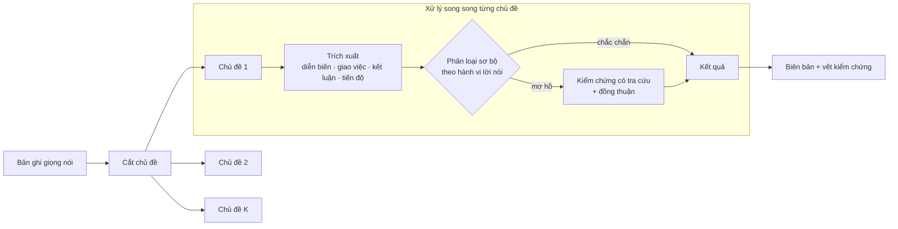

# DiVA: Sinh biên bản họp hành chính tiếng Việt có căn cứ bằng cắt chủ đề hội thoại và đa tác tử kiểm chứng

**DiVA: Grounded Minutes Generation for Vietnamese Administrative Meetings via Dialogue Segmentation and Verified Agents**

*Bản thảo bài báo nghiên cứu, 10/2026.*

---

## Tóm tắt

Trong cơ quan hành chính, biên bản họp không chỉ là bản tóm tắt. Nó là căn cứ để giao trách nhiệm:
ai phải làm gì, phối hợp với ai, hạn khi nào, và cuộc họp đã kết luận gì. Ở phiên họp sau, chính biên
bản này được dùng để kiểm điểm tiến độ. Vì vậy, một hệ thống tự động soạn biên bản phải đúng về
**trách nhiệm**, không chỉ trôi chảy về câu chữ. Hệ thống không được bịa ra một nhiệm vụ, nhầm đơn vị
chủ trì, hay ghi một kiến nghị thành kết luận.

Chúng tôi phát biểu bài toán *sinh biên bản họp có căn cứ* từ bản ghi giọng nói tiếng Việt, gồm bốn
phần: diễn biến, giao việc, kết luận, và tiến độ các việc đã giao từ trước. Chúng tôi đề xuất **DiVA**,
dựa trên hai nguyên tắc: *chỉ tốn chi phí kiểm chứng khi thật sự nghi ngờ*, và *không chắc thì giữ lại
cho người đọc quyết, không tự xoá*. DiVA gồm ba thành phần:

1. bộ cắt chủ đề hội thoại dựa trên độ mạch lạc, không cần biết trước số chủ đề;
2. bộ phân loại hành vi lời nói (giao việc, kết luận, đề xuất…) đã hiệu chỉnh xác suất, dùng để định
   tuyến;
3. cơ chế kiểm chứng, trong đó một tác tử tự tìm bằng chứng trong toàn bộ cuộc họp rồi đi tới đồng thuận
   với tác tử trích xuất.

Kết quả thực nghiệm:

- Bộ chọn ranh giới chủ đề nâng điểm cắt chủ đề trên dữ liệu thật từ 0,39 lên 0,64.
- Bộ phân loại hành vi lời nói nhận ra lời giao việc tốt hơn hẳn luật từ khoá (F1 0,89 so với 0,68) và
  có xác suất được hiệu chỉnh tốt (ECE 0,04). Nhờ vậy chỉ khoảng 20% số lượt nói cần đến bước kiểm chứng
  đắt tiền.
- Trên một cuộc họp có danh sách việc, hệ thống xác định đúng trạng thái cả 4 việc.

Chúng tôi thảo luận các giới hạn và đề xuất một giao thức đánh giá end‑to‑end.

---

## 1. Giới thiệu

Họp là phương thức điều hành chủ yếu của các cơ quan hành chính nhà nước Việt Nam. Ví dụ: giao ban
tuần của UBND, họp chuyên đề về một dự án đầu tư, hay họp Ban Thường vụ. Sau mỗi cuộc họp, bộ phận văn
phòng soạn biên bản, và thường soạn thêm thông báo kết luận của người chủ trì. Đây là văn bản hành chính
chính thức theo quy định về công tác văn thư. Văn bản này xác lập *trách nhiệm*: đơn vị nào chủ trì, đơn
vị nào phối hợp, hạn hoàn thành, và những nội dung đã được thống nhất. Đến kỳ họp sau, danh sách việc
trong biên bản trở thành chương trình kiểm điểm: từng đơn vị báo cáo việc đã xong, đang làm, hay vướng
mắc.

Hiện nay, biên bản chủ yếu do thư ký ghi tay hoặc nghe lại ghi âm để soạn. Với các cuộc họp dài, nhiều
nội dung và nhiều đơn vị tham dự, việc này tốn công và dễ sót. Nhận dạng giọng nói tiếng Việt đã đủ tốt
để tạo bản ghi, và mô hình ngôn ngữ lớn (LLM) viết tóm tắt rất trôi chảy. Tuy nhiên, giữa *một bản tóm
tắt* và *một biên bản dùng được* có khoảng cách lớn. Lỗi trong biên bản có hậu quả hành chính trực tiếp:

- ghi một **đề xuất** của đại biểu thành **chỉ đạo** của người chủ trì;
- giao việc cho nhầm người, ví dụ "anh Sơn" khi cuộc họp có hai người tên Sơn;
- nhầm đơn vị chủ trì với đơn vị phối hợp;
- bỏ sót một lời giao việc nói theo kiểu khẩu ngữ ("anh Phong gửi giúp em trong tuần này được không ạ?");
- báo cáo một việc "đã xong" trong khi người chủ trì vừa yêu cầu làm lại.

Do đó, người dùng cần kiểm tra được từng mục: mục này dựa vào câu nói nào, của ai, ở thời điểm nào.

**Vì sao bài toán khó.** Có bốn lý do:

1. *Độ dài.* Một phiên họp có thể dài hàng trăm nghìn ký tự, gồm nhiều mục nghị sự đan xen.
2. *Ngữ dụng.* Cùng một câu "đề nghị Sở Xây dựng rà soát lại" là chỉ đạo khi người chủ trì nói, nhưng
   chỉ là kiến nghị khi đại biểu nói. Lời giao việc thường không có từ khoá rõ ràng.
3. *Định danh trách nhiệm.* Việc thường giao cho *đơn vị* chứ không cho cá nhân, có nhiều bên với vai
   trò khác nhau, và cách gọi trong bản ghi rất lỏng ("bên em", "anh Sơn", "UBND TP").
4. *Dữ liệu.* Gần như chưa có dữ liệu tiếng Việt có nhãn cho bài toán này. Dữ liệu tổng hợp thì khác xa
   cuộc họp thật, và bộ tách người nói có thể gộp nhiều người vào một nhãn.

**Hạn chế của các cách làm hiện có.** Cách đơn giản nhất là gọi một LLM trên toàn bản ghi hoặc trên
từng đoạn, rồi tin kết quả. Cách này không kiểm soát được lỗi bịa và lỗi gán trách nhiệm. Cách ngược lại
là cho nhiều tác tử tranh luận về mọi mục. Chi phí khi đó tăng theo số mục, và mỗi cuộc tranh luận chỉ
nhìn thấy đoạn hiện tại, trong khi lời chốt có thể nằm ở phần khác của cuộc họp.

**Cách tiếp cận của chúng tôi.** DiVA coi việc soạn biên bản là một bài toán *trích xuất có căn cứ* và
tổ chức việc kiểm chứng theo *mức độ nghi ngờ*:

- Cuộc họp được cắt thành các chủ đề, và các chủ đề được xử lý song song.
- Mỗi mục trích ra phải chỉ được câu nói làm căn cứ.
- Một bộ phân loại hành vi lời nói rẻ và đã hiệu chỉnh quyết định mục nào chắc chắn, mục nào mơ hồ.
- Chỉ các mục mơ hồ mới được chuyển cho một tác tử kiểm chứng. Tác tử này tự tra cứu toàn bộ cuộc họp
  và tranh luận có giới hạn với tác tử đã trích ra mục đó.
- Khi hai bên vẫn không thống nhất, hoặc hệ thống gặp lỗi, mục được giữ lại kèm dấu hiệu để người đọc
  quyết định, thay vì bị xoá.

**Đóng góp.**

1. **Phát biểu bài toán** sinh biên bản họp hành chính có căn cứ, gồm bốn đầu ra (diễn biến, giao việc,
   kết luận, tiến độ việc cũ), cùng các yêu cầu nghiệp vụ: trích dẫn được, định danh người/đơn vị và vai
   trò, chuẩn hoá hạn chót, phân biệt chỉ đạo với kiến nghị.
2. **DiVA**, một kiến trúc *kiểm chứng chọn lọc*. Trong đó, một bộ phân loại hành vi lời nói đã hiệu
   chỉnh vừa quyết định có cần trích xuất hay không, vừa định tuyến mục nghi ngờ sang một cơ chế đồng
   thuận giữa tác tử trích xuất và tác tử kiểm chứng có công cụ tra cứu.
3. **Phương pháp cắt chủ đề** cho cuộc họp tiếng Việt, không cần biết trước số chủ đề, và giữ mỗi đoạn
   trong giới hạn xử lý của LLM.
4. **Phân tích thực nghiệm** trên dữ liệu thật và dữ liệu tổng hợp. Phân tích này cho thấy khoảng cách
   giữa hai loại dữ liệu, giá trị của việc hiệu chỉnh xác suất khi định tuyến, và những điểm mà LLM lẫn
   bộ phân loại còn sai trong theo dõi tiến độ.

---

## 2. Bài toán

### 2.1. Biên bản họp hành chính cần gì

Chúng tôi xác định yêu cầu từ quy trình soạn biên bản của bộ phận văn phòng và từ các biên bản thật mà
nhóm thu thập được.

| Phần | Nội dung | Yêu cầu nghiệp vụ |
|---|---|---|
| Diễn biến họp | Ý kiến chính của từng người phát biểu theo từng nội dung | Đúng người, không gán ý của người này cho người khác |
| Giao việc | Ai làm gì, chủ trì/phối hợp, hạn khi nào | Chỉ ghi khi có người có thẩm quyền giao hoặc có người nhận; đúng người/đơn vị; hạn quy được về ngày |
| Kết luận | Nội dung đã được chốt, thống nhất | Phân biệt kết luận với đề xuất chưa được chấp nhận |
| Tiến độ | Tình trạng các việc đã giao từ trước | Không bỏ việc nào; biết việc nào chưa được báo cáo, quá hạn, bị yêu cầu làm lại |

Cả bốn phần có chung một yêu cầu: **truy vết được**. Mỗi mục phải chỉ ra được câu nói làm căn cứ, để
người duyệt kiểm tra trong vài giây thay vì nghe lại cả cuộc họp.

### 2.2. Phát biểu hình thức

Đầu vào là bản ghi gồm các lượt nói $\mathcal T=(u_1,\dots,u_n)$, mỗi lượt có người nói và nội dung. Kèm
theo có thể có một số thông tin của phiên họp:

- ngày họp và người chủ trì;
- danh sách người/đơn vị tham dự;
- danh sách việc cần báo cáo $\mathcal G$, mỗi việc có đơn vị chủ trì, hạn và trạng thái trước phiên họp.

Đầu ra gồm bốn tập:

- **Diễn biến** $\mathcal D$: các luận điểm $(\text{người nói}, \text{nội dung}, E)$.
- **Giao việc** $\mathcal A$: các mục $(\text{nội dung}, \text{các bên nhận việc kèm vai trò}, \text{hạn}, E, t^\*)$.
- **Kết luận** $\mathcal C$: các mục $(\text{nội dung}, E, t^\*)$.
- **Tiến độ** $\mathcal P$: mỗi việc $g\in\mathcal G$ có trạng thái mới, thuộc tập
  {xong, đang làm, vướng mắc, phải làm lại, hoãn, chỉ được nhắc, không được báo cáo}, kèm bằng chứng.

Ở đây $E$ là tập lượt nói làm bằng chứng. $t^\*$ là *lượt quyết định*: lượt giao/nhận việc, hoặc lượt
chốt. Ràng buộc căn cứ gồm ba điều:

- mọi bằng chứng là lượt nói thật;
- mọi việc giao và kết luận sau kiểm chứng phải có lượt quyết định (lượt này có thể nằm ở phần khác của
  cuộc họp);
- không việc nào trong $\mathcal G$ bị bỏ khỏi đầu ra.

### 2.3. Thách thức

- **T1. Ngữ cảnh dài.** Một cuộc họp không vừa một lần xử lý, nên phải cắt thành chủ đề. Nhưng lời giao
  việc ở chủ đề này có thể được chốt ở chủ đề khác.
- **T2. Hành vi lời nói.** Giao việc, kết luận, đề xuất và báo cáo phân biệt với nhau theo *nghĩa* và
  theo *vai người nói*, không theo từ khoá.
- **T3. Trách nhiệm.** Người nhận việc có thể là cá nhân hoặc đơn vị, có nhiều bên với vai trò khác
  nhau, và cách gọi không chuẩn.
- **T4. Chi phí và độ tin cậy.** Kiểm chứng mọi mục bằng LLM là quá đắt. Không kiểm chứng thì lỗi bịa
  lọt ra ngoài.
- **T5. Dữ liệu ít và lệch.** Dữ liệu có nhãn rất ít, dữ liệu tổng hợp khác dữ liệu thật, và nhãn người
  nói không tin cậy.

---

## 3. Công trình liên quan

**Tóm tắt và trích xuất từ cuộc họp.** Các nghiên cứu trên kho AMI và ICSI (Carletta et al., 2005;
Janin et al., 2003) bao gồm phát hiện việc cần làm (Purver et al., 2007) và tóm tắt theo truy vấn
(QMSum; Zhong et al., 2021). Các nghiên cứu này chủ yếu cho tiếng Anh và cho bối cảnh doanh nghiệp. Chúng
ít đòi hỏi trích dẫn tới từng câu, không định danh đơn vị, và không theo dõi tiến độ việc qua các phiên.

**Cắt chủ đề hội thoại.** Các phương pháp đi từ đo độ tương đồng giữa hai cửa sổ (TextTiling; Hearst,
1997) và phân cụm trên embedding (TreeSeg; Gklezakos et al., 2024), tới chấm điểm mạch lạc giữa các lượt
nói (Xing & Carenini, 2021; DialSTART, Gao et al., 2023). Các nghiên cứu gần đây cho thấy chọn độ mịn
khi cắt ảnh hưởng tới kết quả nhiều không kém chọn phương pháp. Đây là điểm chúng tôi tập trung xử lý.

**Tác tử LLM và tự kiểm chứng.** ReAct (Yao et al., 2023) cho mô hình xen kẽ suy luận và tra cứu. Tranh
luận đa tác tử (Du et al., 2023; Liang et al., 2023) và tự sửa lỗi (Madaan et al., 2023; Gou et al.,
2024) dùng phản hồi để cải thiện đầu ra. Các hướng định tuyến theo độ tin cậy (Geifman & El‑Yaniv,
2017; Chen et al., 2023) chỉ chuyển sang mô hình đắt hơn khi cần. DiVA kết hợp hai hướng này: định tuyến
bằng bộ phân loại đã hiệu chỉnh, và tranh luận *có neo bằng chứng, có ngân sách, có quy tắc an toàn*,
chỉ dành cho phần mơ hồ.

---

## 4. Phương pháp DiVA

### 4.1. Tổng quan

DiVA dựa trên ba nguyên tắc thiết kế:

- **(P1) Căn cứ trước, nội dung sau.** Mọi tác tử phải chỉ ra lượt nói làm căn cứ trước khi viết nội
  dung hay đưa ra kết luận.
- **(P2) Chi phí tỉ lệ với mức nghi ngờ.** Kiểm tra rẻ chạy cho mọi mục; kiểm chứng đắt chỉ chạy cho mục
  mơ hồ.
- **(P3) An toàn khi không chắc.** Lỗi hệ thống hay bất đồng không giải quyết được thì *giữ* mục kèm dấu
  hiệu cho người duyệt, không tự xoá.

### 4.2. Cắt chủ đề dựa trên mạch lạc

Chúng tôi huấn luyện lại mô hình DialSTART cho tiếng Việt. Với mỗi khe giữa hai lượt nói liên tiếp, mô
hình cho một điểm liền mạch kết hợp hai tín hiệu: lượt sau có *nối tiếp* được lượt trước không, và hai
cửa sổ hai bên có *cùng chủ đề* không:

$$
\text{score}(g)=\sigma\big(\text{coh}(u_{\le g},u_{g+1})+\cos(\bar{\mathbf e}_{\text{trái}},\bar{\mathbf e}_{\text{phải}})\big).
$$

Khe có điểm "lõm" sâu so với hai đỉnh lân cận là ứng viên ranh giới.

Mô hình gốc được đánh giá với *số chủ đề đã biết trước*. Khi chạy thật thì không có số này. Chúng tôi đề
xuất một bộ chọn ranh giới gồm bốn bước:

1. làm mượt điểm để bỏ các chỗ lõm giả do câu xen ngang ("Vâng", "Mời anh…");
2. giữ các khe sâu hơn một ngưỡng thích nghi theo phân bố điểm của chính cuộc họp đó;
3. bỏ các đoạn quá ngắn, với độ dài tối thiểu tỉ lệ theo độ dài cuộc họp;
4. tách các đoạn vượt giới hạn xử lý của LLM.

Nhờ vậy, cùng một cấu hình chạy được cho cả cuộc họp 5 nghìn ký tự lẫn 260 nghìn ký tự.

### 4.3. Xử lý song song với ngữ cảnh toàn cuộc họp

Nếu xử lý chủ đề tuần tự để mang thông tin người nói từ chủ đề trước sang chủ đề sau, thời gian sẽ tăng
tuyến tính theo số chủ đề. DiVA dựng *một lần* cho cả cuộc họp một **danh bạ** gồm người nói, người chủ
trì, người/đơn vị tham dự và danh sách việc. Sau đó mọi chủ đề được xử lý song song và độc lập.

Mỗi chủ đề có các tác tử trích xuất riêng: diễn biến, giao việc, kết luận, và tiến độ (khi có danh sách
việc). Prompt của các tác tử mã hoá quy tắc nghiệp vụ. Hai quy tắc tiêu biểu:

- *"Đề nghị/yêu cầu + người/đơn vị + việc" do người chủ trì nói là giao việc, kể cả khi không có chữ
  "giao".*
- *Chỉ khai một mục là "đề xuất" khi không chắc chắn.*

Kết quả cuối được ghép lại theo thứ tự chủ đề, và các mục trùng giữa các chủ đề được gộp lại.

### 4.4. Định tuyến theo hành vi lời nói đã hiệu chỉnh

Chúng tôi dùng một bộ phân loại $h$ gán cho mỗi lượt nói (kèm 2 lượt ngữ cảnh) một phân bố trên sáu hành
vi: *giao việc, kết luận, đề xuất, bác bỏ, thảo luận, khác*. Bộ phân loại được hướng dẫn xét theo nghĩa
và theo vai người nói. Xác suất "chốt" là

$$
p_{\text{chốt}}(u)=h(\text{giao việc}\mid u)+h(\text{kết luận}\mid u).
$$

Vì xác suất này được hiệu chỉnh tốt (Mục 6.2), hai ngưỡng $\tau_{\text{thấp}}=0{,}2$ và
$\tau_{\text{cao}}=0{,}8$ chia lượt nói thành ba vùng có ý nghĩa nghiệp vụ: *rõ là không chốt*, *mơ hồ*,
và *rõ là chốt*. Bộ phân loại được dùng ở hai chỗ:

- **Cổng trích xuất.** Tác tử giao việc và tác tử kết luận chỉ chạy trên chủ đề có ít nhất một lượt nói
  với $p_{\text{chốt}}\ge\tau_{\text{thấp}}$. Ngưỡng thấp được chọn có chủ đích: chạy thừa chỉ tốn chi
  phí, còn bỏ nhầm thì mất nội dung.
- **Phân loại sơ bộ.** Với mỗi mục giao việc hoặc kết luận, lượt quyết định mà tác tử khai được đưa qua
  $h$:
  - vùng *rõ là chốt*: mục được chấp nhận ngay, nếu các kiểm tra luật khác cũng đạt (người nhận việc có
    thật, không mơ hồ giữa nhiều người);
  - vùng *mơ hồ* hoặc *rõ là không*: mục được chuyển sang kiểm chứng.

### 4.5. Kiểm chứng có tra cứu và đồng thuận

**Tác tử kiểm chứng** hoạt động theo kiểu ReAct. Nó có ba công cụ chỉ đọc, phạm vi là *toàn bộ cuộc
họp*: đọc một lượt nói, tìm các lượt liên quan theo từ khoá, và tra ứng viên người/đơn vị cho một cách
gọi. Kết luận của tác tử kiểm chứng là *giữ*, *sửa*, *bỏ* hoặc *chưa kết luận được*. Có ba ràng buộc đi
kèm:

- Tác tử phải chỉ ra lượt quyết định *trước* khi đưa ra kết luận (P1). Kết luận *giữ* hoặc *sửa* mà không
  có lượt quyết định có thật thì tự động bị hạ thành *bỏ*.
- Dấu hiệu nghi ngờ của bước phân loại sơ bộ chỉ được coi là gợi ý, không được coi là bằng chứng.
- Số bước tra cứu bị giới hạn.

**Đồng thuận.** Khi tác tử kiểm chứng không giữ nguyên một mục, phản hồi của nó được gửi lại cho chính
tác tử đã trích ra mục đó. Tác tử này chọn một trong ba lập trường:

- *chấp nhận*: theo đề nghị của bên kiểm chứng;
- *sửa*: sửa mục theo bản ghi, phải kèm lượt quyết định có thật;
- *bảo vệ*: giữ nguyên mục và chỉ ra lượt quyết định mà bên kiểm chứng đã bỏ sót.

Hai bên trao đổi tối đa $R$ vòng. Kết quả cuối được xác định như sau:

| Kết thúc | Kết quả |
|---|---|
| Hai bên thống nhất | Theo kết quả thống nhất |
| Hết vòng, bên kiểm chứng đã có kết luận | Theo bên kiểm chứng |
| Hết vòng, bên kiểm chứng vẫn chưa kết luận được | Giữ mục **gốc**, đánh dấu cho người duyệt |
| Lỗi hệ thống | Giữ mục **gốc**, đánh dấu cho người duyệt |

Bảng này cụ thể hoá P3. Mọi vòng trao đổi được lưu lại thành *vết kiểm chứng* để người duyệt xem vì sao
một mục được giữ, sửa hay bỏ.

### 4.6. Định danh trách nhiệm

Với mỗi cách gọi người nhận việc, ví dụ "anh Sơn" hay "Sở Tài chính chủ trì, phối hợp Sở Xây dựng", DiVA
tách thành các bên kèm vai trò (chủ trì, phối hợp, cùng thực hiện). Sau đó mỗi bên được chấm điểm ứng
viên theo ba nguồn, lần lượt ưu tiên:

1. *tên*: khớp đầy đủ, khớp một phần, hay chỉ khớp tên gọi;
2. *ngữ cảnh hội thoại*: người đáp lời ngay sau lời giao thường là người nhận việc, còn người giao việc
   thì không tự gọi mình bằng tên;
3. *chức năng*: chức vị hoặc chức năng của đơn vị khớp với nội dung việc.

Khi không ứng viên nào đủ rõ, việc giao vẫn được giữ, kèm danh sách ứng viên và điểm để người duyệt
chọn. Hệ thống không tự đoán.

### 4.7. Theo dõi tiến độ việc đã giao

Khi phiên họp có danh sách việc cũ, tác tử tiến độ trích ra trạng thái của từng việc được nhắc tới. Sau
đó trạng thái được kiểm bằng bộ phân loại. Một quan sát nghiệp vụ quan trọng là **có hai kiểu việc**:

- *việc báo cáo* (ví dụ "báo cáo tình hình các dự án"): xong khi nội dung đã được trình bày tại cuộc họp;
- *việc làm ra sản phẩm* (tờ trình, hồ sơ, văn bản): xong khi sản phẩm đã có.

Với việc báo cáo, tình trạng của *đối tượng* được báo cáo ("dự án đang làm thủ tục") là nội dung của báo
cáo, không phải trạng thái của *việc*. Vì vậy DiVA phân loại kiểu việc trước, rồi đặt câu hỏi kiểm phù
hợp với kiểu đó.

Các cập nhật của cùng một việc được gộp theo hai quy tắc. Thứ nhất, **lời chỉ đạo của người có thẩm
quyền thắng lời báo cáo**: báo cáo "xong" rồi chủ trì yêu cầu làm lại thì kết quả là *phải làm lại*,
kèm cờ mâu thuẫn. Thứ hai, cùng loại thì lời muộn hơn thắng. Việc không được ai nhắc tới được đánh dấu
*không được báo cáo*, và việc quá hạn mà chưa xong được đánh dấu *quá hạn*.

Mỗi việc giao mới cũng được xếp quan hệ với danh sách việc cũ: *việc mới*, *tiếp nối*, *giao lại cho bên
khác*, hoặc *đổi hạn*. Thông tin này giúp văn phòng cập nhật sổ theo dõi nhiệm vụ.

---

## 5. Thiết lập thực nghiệm

**Câu hỏi nghiên cứu.**

- **RQ1.** Có cắt được chủ đề cuộc họp thật mà không cần biết trước số chủ đề không?
- **RQ2.** Bộ phân loại hành vi lời nói đã hiệu chỉnh có định tuyến kiểm chứng tốt hơn luật từ khoá
  không?
- **RQ3.** Có thể dùng bộ phân loại để bỏ qua bước trích xuất ở chủ đề không có giao việc/kết luận mà
  không mất nội dung không?
- **RQ4.** Theo dõi tiến độ có xác định đúng trạng thái việc không, và những yếu tố nào quyết định độ
  chính xác?
- **RQ5.** Hệ thống có chạy được trong thời gian chấp nhận được trên cuộc họp dài không?

**Dữ liệu.**

| Tập | Mô tả |
|---|---|
| Quốc hội | 47 phiên Quốc hội khoá XIII có chủ đề gán tay; 12 phiên dùng để đánh giá cắt chủ đề |
| Họp hành chính (gold) | 3 cuộc họp thật có ranh giới chủ đề đã duyệt |
| Tổng hợp | 30 cuộc họp tổng hợp tiếng Việt; 869 lượt nói có nhãn hành vi lời nói; 166 kết luận gold |
| Họp có danh sách việc | 1 cuộc họp thật (32 lượt, 3 chủ đề) với 4 việc cần báo cáo, có trạng thái gold |
| Họp dài | 1 cuộc họp thật 1.259 lượt nói, 14 chủ đề |

**Độ đo.**

- Cắt chủ đề: $P_k$, F1 ranh giới, và điểm tổng hợp $S=\tfrac14(\text{F1}_{2k}+\text{F1}_{5k}+2-2P_k)$.
- Hành vi lời nói: Precision, Recall, F1, và sai số hiệu chỉnh ECE.
- Tiến độ: số việc có trạng thái khớp gold.
- Thời gian chạy.

**Mô hình.** Bộ cắt chủ đề dùng backbone BERT tiếng Việt (vibert4news). Các tác tử trích xuất dùng một
LLM mở (gemma). Tác tử kiểm chứng dùng gpt‑4o‑mini. Bộ phân loại hành vi lời nói là một API phân loại
trả về phân bố xác suất. Các siêu tham số: $R=3$ vòng đồng thuận, tối đa 3 lần tra cứu mỗi vòng.

---

## 6. Kết quả và phân tích

> Các kết quả dưới đây đánh giá từng thành phần trên các tập khác nhau. Chất lượng end‑to‑end của phần
> Giao việc và Kết luận chưa được đo trên dữ liệu thật có nhãn (Mục 7).

### 6.1. RQ1: Cắt chủ đề

**Bảng 1. Khoảng cách giữa dữ liệu tổng hợp và dữ liệu thật.**

| Cấu hình | Dữ liệu | Kết quả |
|---|---|---|
| Mô hình, biết trước số chủ đề | Tổng hợp | $P_k=0{,}011$ |
| Mô hình, chưa có bộ chọn ranh giới | Họp thật | $P_k=0{,}485$, cắt quá vụn |
| + bộ chọn ranh giới (cấu hình ban đầu) | Thật / tổng hợp | $S=0{,}392$ / $0{,}336$ |
| **+ bộ chọn ranh giới (đề xuất)** | Thật / tổng hợp | $S=\mathbf{0{,}637}$ / $\mathbf{0{,}686}$ |

Mô hình gần như hoàn hảo trên dữ liệu tổng hợp nhưng hỏng trên cuộc họp thật. Bộ chọn ranh giới thu hẹp
phần lớn khoảng cách này. Tương quan giữa điểm trên dữ liệu tổng hợp và điểm trên dữ liệu thật chỉ ở mức
vừa (Spearman 0,56). Điều này nhắc rằng không nên tinh chỉnh chỉ dựa trên dữ liệu tổng hợp.

Trên 12 phiên Quốc hội, bỏ bước làm mượt làm F1 giảm từ 0,418 xuống 0,297. Đây là bước có ảnh hưởng lớn
nhất trong bộ chọn ranh giới.

**Giới hạn nội tại.** Ít nhất 49,5% số cặp (đại biểu, phiên họp) có một lượt phát biểu chứa nhiều chủ
đề. Vì vậy, mọi phương pháp cắt theo lượt nói đều có một mức sai số không tránh được trên dạng dữ liệu
này.

### 6.2. RQ2: Hành vi lời nói và định tuyến kiểm chứng

**Bảng 2. Nhận diện lượt chốt (giao việc/kết luận) trên 869 lượt nói.**

| Phương pháp | P | R | F1 |
|---|---|---|---|
| Luật từ khoá | 0,774 | 0,610 | 0,682 |
| Bộ phân loại, ngưỡng 0,5 | **0,863** | **0,928** | **0,894** |
| Bộ phân loại, ngưỡng 0,8 | 0,923 | 0,816 | 0,866 |

Sai số hiệu chỉnh ECE là 0,040: khi bộ phân loại nói 90% thì thực tế đúng xấp xỉ 90%. Tính chất này cho
phép dùng ngưỡng như một chính sách nghiệp vụ.

**Bảng 3. Ba vùng định tuyến.**

| Vùng | Tỉ lệ lượt nói | Tỉ lệ thật sự là lời chốt | Xử lý |
|---|---|---|---|
| $p<0{,}2$ | 31% | 4% | coi là không chốt |
| $0{,}2\le p<0{,}8$ | 20% | 45% | chuyển kiểm chứng |
| $p\ge0{,}8$ | 49% | 92% | chấp nhận |

Chỉ khoảng 20% lượt nói thật sự mơ hồ, với tỉ lệ đúng gần như tung đồng xu. Đây đúng là phần nên dành
cho bước kiểm chứng đắt tiền.

**Phân tích lỗi.**

- Lợi ích lớn nhất nằm ở **lời giao việc khẩu ngữ**: tỉ lệ nhận ra tăng từ 51% lên 91%. Ví dụ "Anh
  Phong gửi giúp em trong tuần này được không ạ?" bị luật từ khoá bỏ qua vì là câu hỏi, còn bộ phân loại
  cho $p=0{,}95$.
- Hai loại còn khó là *việc chưa có người nhận* và *quyết định bị thay thế sau đó*. Cả hai cần ngữ cảnh
  rộng hơn vài lượt nói, và đó chính là lý do tác tử kiểm chứng được tra cứu toàn bộ cuộc họp.

### 6.3. RQ3: Bỏ qua trích xuất an toàn

Chúng tôi mô phỏng các cách bỏ qua tác tử giao việc/kết luận trên 30 cuộc họp tổng hợp.

**Bảng 4. Tiêu chí bỏ qua và nội dung bị mất.**

| Tiêu chí | Nội dung gold bị mất |
|---|---|
| Không có từ khoá giao/chốt nào | 1 việc giao + 2 kết luận (dù chỉ bỏ được 3/304 lần chạy) |
| Lọc riêng theo xác suất "kết luận" | 5/166 kết luận |
| **Không lượt nào có $p_{\text{chốt}}\ge0{,}2$ (đề xuất)** | **0** |

Từ khoá vừa không tiết kiệm được gì vừa làm mất nội dung. Lọc riêng theo từng nhãn cũng làm mất kết
luận, vì một số lời chốt kết luận được bộ phân loại xếp vào nhãn giao việc. Dùng xác suất "chốt" gộp cả
hai nhãn ở ngưỡng thấp thì không mất mục nào. Phần tiết kiệm bị chặn trên bởi tỉ lệ chủ đề không có giao
việc lẫn kết luận, khoảng 18% trên dữ liệu tổng hợp.

### 6.4. RQ4: Theo dõi tiến độ

Trên cuộc họp có danh sách việc (3 việc thật được giao từ trước, cộng 1 việc giả lập không được nhắc
tới), DiVA xác định đúng trạng thái **4/4 việc** ở cả 4 lần chạy. Việc giả lập được đánh dấu đúng là
*không được báo cáo*. Yêu cầu "làm lại tờ trình" được xếp đúng là *tiếp nối* việc cũ, còn các việc phát
sinh trong phiên được xếp là *việc mới*.

Phân tích cho thấy ba yếu tố quyết định độ chính xác:

1. **Chất lượng danh sách việc đầu vào.** Ở phiên bản danh sách đầu tiên, 3/6 "việc cũ" thực ra là việc
   phát sinh ngay trong phiên. Hệ thống chỉ khớp 3/6, và mỗi lần chạy khớp một bộ 3 việc khác nhau. Định
   nghĩa thế nào là "việc cũ" là quyết định nghiệp vụ, không phải lỗi mô hình.
2. **Câu hỏi kiểm phải hợp với kiểu việc.** Với việc "báo cáo tình hình các dự án", câu hỏi chung xếp
   lượt trả lời là "đang làm" (0,92), vì các dự án đang làm thủ tục. Câu hỏi dành cho việc báo cáo xếp
   đúng là "đã báo cáo" (0,99). Bộ phân loại kiểu việc tách được việc báo cáo (1,00) khỏi các việc làm
   ra sản phẩm (tờ trình 0,35; tiếp thu góp ý 0,03).
3. **Phân công giữa tác tử và bộ phân loại.** Có trường hợp câu "đã giải trình, tiếp thu" nằm trong một
   đoạn dài nói về đề án "tiếp tục hoàn thiện", và bộ phân loại xếp "đang làm". Ba cách viết lại câu hỏi
   đều không sửa được mà không làm hỏng trường hợp khác. Vì vậy chúng tôi để tác tử, vốn đọc cả chủ đề,
   quyết "xong hay đang làm". Bộ phân loại chỉ quyết lượt nói là *báo cáo*, *chỉ đạo* hay *chỉ nhắc
   tới*. Bộ phân loại cũng ngăn một *kiến nghị* của đại biểu biến một việc đã xong thành "phải làm lại".

Ngoài ra, cùng một đầu vào, LLM mở vẫn có thể cho kết quả khác nhau giữa các lần chạy, và cắt chủ đề khác
đi cũng làm prompt thay đổi. So sánh hai cấu hình chỉ có ý nghĩa khi giữ cố định phân đoạn chủ đề và
chạy lặp lại nhiều lần.

### 6.5. RQ5: Thời gian chạy

Cuộc họp 1.259 lượt nói, 14 chủ đề được xử lý trong khoảng **78 giây**, trong đó cắt chủ đề mất 12 giây.
Lần đo này thực hiện trước khi có vòng đồng thuận. Nhờ xử lý song song, thời gian không còn tăng tuyến
tính theo số chủ đề như ở cách xử lý tuần tự.

Chi phí kiểm chứng cho mỗi mục mơ hồ bị chặn trên, tối đa 15 lần gọi LLM. Trong ví dụ điển hình, tác tử
kiểm chứng tìm thấy lời giao việc thật của người chủ trì ở lượt khác, tác tử trích xuất sửa người nhận
việc theo đó, và hai bên thống nhất sau 2 vòng, tổng cộng 4 lần gọi.

---

## 7. Thảo luận

**Ý nghĩa nghiệp vụ.** DiVA không thay người soạn biên bản. Nó chuyển công việc từ *nghe lại và viết*
sang *duyệt có trích dẫn*. Mỗi mục kèm câu nói làm căn cứ. Mục mơ hồ được đánh dấu kèm lý do và các ứng
viên người nhận việc. Vết kiểm chứng cho người duyệt biết vì sao một mục được giữ hay bỏ. Thiết kế "không
chắc thì giữ lại và đánh dấu" chấp nhận nhiều mục cần duyệt hơn để đổi lấy việc không âm thầm mất nội
dung. Với biên bản hành chính, sót một chỉ đạo thường đắt hơn duyệt thừa một mục.

**Hạn chế.**

- *Chưa có đánh giá end‑to‑end* cho Giao việc và Kết luận trên dữ liệu thật có nhãn. Cũng chưa kiểm
  chứng được rằng vòng đồng thuận không khiến một bên nhượng bộ sai.
- *Dữ liệu đánh giá nhỏ*: 3 cuộc họp cho cắt chủ đề, 1 cuộc họp cho tiến độ, đều do một người gán nhãn.
  Các khác biệt nhỏ có thể nằm trong vùng nhiễu.
- *Lệch giữa dữ liệu tổng hợp và dữ liệu thật*: bộ cắt chủ đề và các ngưỡng của bộ phân loại đều được
  chọn phần lớn trên dữ liệu tổng hợp. Các ngưỡng cho phần tiến độ chưa được hiệu chỉnh riêng.
- *Đơn vị là lượt nói*: không tách được lượt nói chứa nhiều chủ đề. Khi bộ tách người nói gộp nhiều
  người vào một nhãn, vai người nói (chủ trì hay trình bày) có thể bị hiểu sai.
- *Thiên lệch tự đồng ý*: tác tử trả lời phản hồi chính là tác tử đã trích ra mục đó. Dùng mô hình khác
  họ cho bên kiểm chứng giảm rủi ro này nhưng không loại bỏ hẳn.

**Triển khai có trách nhiệm.** Nội dung họp của cơ quan nhà nước có thể nhạy cảm. Hệ thống nên chạy trên
hạ tầng được phép, ưu tiên mô hình triển khai nội bộ cho các bước xử lý toàn văn. Biên bản cuối cùng vẫn
phải do người có thẩm quyền duyệt.

**Giao thức đánh giá đề xuất.** Bước tiếp theo là xây gold end‑to‑end gồm 3–5 biên bản có danh sách
việc, có hai người gán nhãn độc lập, rồi đo các ablation sau:

1. tắt cổng trích xuất, để đo recall và chi phí;
2. dùng danh bạ toàn cuộc họp so với ngữ cảnh chuyển dồn giữa các chủ đề;
3. thay đổi số vòng đồng thuận, hoặc bỏ hẳn vòng đồng thuận;
4. so sánh kiểm chứng có tra cứu toàn cuộc họp với tranh luận chỉ trong đoạn;
5. so sánh các bộ cắt chủ đề khác nhau;
6. so sánh câu hỏi tiến độ chung với câu hỏi tuỳ kiểu việc.

---

## 8. Kết luận

Chúng tôi phát biểu bài toán sinh biên bản họp hành chính tiếng Việt có căn cứ, trong đó đúng *trách
nhiệm* quan trọng hơn đẹp câu chữ, và đề xuất DiVA. DiVA cắt cuộc họp thành chủ đề, xử lý song song, và
dùng một bộ phân loại hành vi lời nói đã hiệu chỉnh để quyết định nơi cần trích xuất và nơi cần kiểm
chứng. Việc kiểm chứng dành cho một tác tử có tra cứu toàn cuộc họp, làm việc theo cơ chế đồng thuận với
quy tắc an toàn. Thực nghiệm thành phần cho thấy ba điều: hiệu chỉnh xác suất là điều kiện để định tuyến
hiệu quả; từ khoá không đủ để nhận ra lời giao việc tiếng Việt; và trong theo dõi tiến độ, cần phân biệt
việc báo cáo với việc làm ra sản phẩm. Đánh giá end‑to‑end trên dữ liệu thật mở rộng là bước tiếp theo
cần thiết.

---

## Tài liệu tham khảo

- Carletta, J. et al. (2005). The AMI Meeting Corpus: A Pre-announcement. *MLMI*.
- Chen, L., Zaharia, M., Zou, J. (2023). FrugalGPT: How to Use Large Language Models While Reducing Cost and Improving Performance. arXiv:2305.05176.
- Du, Y., Li, S., Torralba, A., Tenenbaum, J., Mordatch, I. (2023). Improving Factuality and Reasoning in Language Models through Multiagent Debate. arXiv:2305.14325.
- Gao, H., Wang, R., Lin, T.-E., Wu, Y., Yang, M., Huang, F., Li, Y. (2023). Unsupervised Dialogue Topic Segmentation with Topic-aware Utterance Representation. *SIGIR*.
- Geifman, Y., El-Yaniv, R. (2017). Selective Classification for Deep Neural Networks. *NeurIPS*.
- Gklezakos, D. et al. (2024). TreeSeg: Hierarchical Topic Segmentation of Large Transcripts. arXiv:2407.12028.
- Gou, Z. et al. (2024). CRITIC: Large Language Models Can Self-Correct with Tool-Interactive Critiquing. *ICLR*.
- Hearst, M. (1997). TextTiling: Segmenting Text into Multi-paragraph Subtopic Passages. *Computational Linguistics* 23(1).
- Janin, A. et al. (2003). The ICSI Meeting Corpus. *ICASSP*.
- Liang, T. et al. (2023). Encouraging Divergent Thinking in Large Language Models through Multi-Agent Debate. arXiv:2305.19118.
- Madaan, A. et al. (2023). Self-Refine: Iterative Refinement with Self-Feedback. *NeurIPS*.
- Purver, M., Dowding, J., Niekrasz, J., Ehlen, P., Noorbaloochi, S., Peters, S. (2007). Detecting and Summarizing Action Items in Multi-Party Dialogue. *SIGdial*.
- Xing, L., Carenini, G. (2021). Improving Unsupervised Dialogue Topic Segmentation with Utterance-Pair Coherence Scoring. *SIGdial*.
- Yao, S. et al. (2023). ReAct: Synergizing Reasoning and Acting in Language Models. *ICLR*.
- Zhong, M. et al. (2021). QMSum: A New Benchmark for Query-based Multi-domain Meeting Summarization. *NAACL*.
